# Crónicas de Iberia (Chronicles of Iberia) — Open-World-Survival-Spiel im vorrömischen Iberien

> Ein Open-World-Survival-Abenteuer aus der Third-Person-Perspektive im vorrömischen Iberien um 225 v. Chr. Vor der Demo, in Entwicklung.

> **Hinweis: Das Spiel ist in Entwicklung.** Crónicas de Iberia ist noch nicht fertig. Die Bilder auf dieser Seite sind Arbeitsstände und können sich noch ändern. *Aktualisiert am 25.11.2026.*

Von [Shania Webstudio](https://shaniawebstudio.com), Granada (Spanien).

[English](README.md) · [Español](README.es.md) · [Français](README.fr.md) · **Deutsch** · [Português](README.pt.md)

*Echte Aufnahme aus der Engine, Prototyp-Grafik.*

## Konzept

Du bist ein Schutzgeist, gebunden an ein iberisches Heiligtum in einer Höhle. Du erwachst, sooft die Halbinsel in eine Krise gerät, und schläfst wieder ein, wenn die Krise vorbei ist. Überlebe, kämpfe und erkunde eine Open-World-Welt aus der Third-Person-Perspektive. Sie ist von den vorrömischen Völkern der Iberischen Halbinsel inspiriert: Iberer, Kelten und Keltiberer.

Dich führt die Stimme des Heiligtums. Gegen dich steht die Asche, die alle Völker gleichermaßen verdirbt: In diesem Spiel ist keine Kultur „die böse“. Die Stimme und die Asche sind die beiden Hälften des Gedächtnisses des Landes: Die eine singt, was war, die andere verbrennt, woran sich niemand erinnern will.

Der offizielle Titel lautet „Crónicas de Iberia“; „Chronicles of Iberia“ ist ein vorläufiger englischer Titel.

## Die Ären

Die Geschichte wird in Ären erzählt. Wir bauen die erste ganz fertig, bevor wir die nächste beginnen.

| Ära | Zeit | Stand |
|---|---|---|
| 1 · Iberisch | Um 225 v. Chr., bevor Rom auf die Halbinsel kommt | In Entwicklung: Sie wird im Prototyp gespielt |
| Punisches Zwischenspiel | Qart Hadasht (Cartagena), gegründet um 227 v. Chr. | In Planung |
| 2 · Römisches Hispanien | Von 150 v. Chr. bis zum 1. Jahrhundert n. Chr.: Viriatus, Numantia, Las Médulas, Emerita Augusta | In Planung |
| 3 · Westgotenreich | Ende des 7. Jahrhunderts und das Jahr 711 | In Planung |
| 4 · Al-Andalus | 10. Jahrhundert | In Planung |
| 5 · Kastilien des Cid | 11. Jahrhundert | In Planung |
| 6 · Granada | 1492 | In Planung |

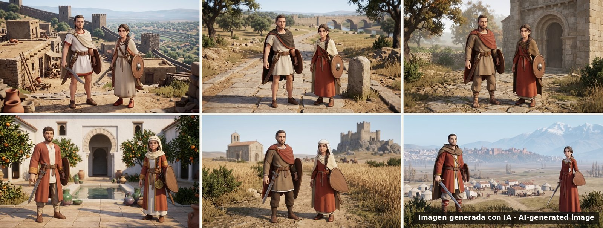

*KI-generierte Konzeptgrafik (Google Gemini), vom Studio überarbeitet: kein Screenshot aus dem Spiel.*

## Die Hauptfigur

Zu Beginn des Spiels wählst du, wen du weckst: **Neitin**, die Wächterin, oder **Iltir**, den Wächter. Das sind vorläufige Namen, die von der iberischen Namenkunde inspiriert sind. Du kannst sie ändern. Das Gesicht ist in allen Ären gleich: braune Augen und dunkelbraunes Haar, bei ihr mit langem Zopf, bei ihm mit Pferdeschwanz. Die Kleidung wechselt mit jeder Ära.

Auf dem Rücken der linken Hand leuchtet das **Zeichen des Heiligtums**, eine goldene Zeichnung, die mit jeder Ära einen Strich dazugewinnt. Die Hauptfigur spricht nicht: In Dialogen wählst du zwischen Antworten.

In der Entwicklungsversion stehen die Füße auf dem Gelände, und die Arme bewegen sich beim Gehen und Laufen. Sie schwimmt auch (Kraulen oder Hundepaddeln), treibt im Wasser, kommt am Ufer wieder heraus und schaut auf das, was in der Nähe ist. Das wird noch getestet.

## Die Menschen in den Dörfern

Die iberischen Dörfer bekommen neue Figuren, in 3D modelliert, jede mit eigener Kleidung, eigener Frisur und eigenem Schmuck. Sie werden noch getestet.

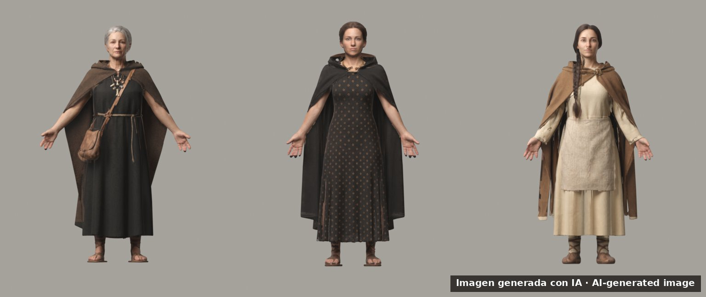

*Render (Modellansicht, ohne Animation) von KI-generierten 3D-Modellen auf Grundlage von Konzepten aus Google Gemini.*

## Welt und echter Maßstab

- **Echter Maßstab:** Im Spiel ist 1 Einheit 1 Meter. Ein automatischer Test vergleicht die Höhe von Menschen und Tieren, Bäumen und Häusern mit echten Maßen und lässt eine Abweichung von ±15 % zu.
- **Region 1 · Edetanien und das Gebirge im Norden:** eine Region von 2 × 2 km mit Gelände, Vegetation, einem Fluss mit Strömung und Brücken. Sie hat ein iberisches Oppidum nach dem Vorbild von Edeta (Tossal de Sant Miquel, Llíria), mit NPCs, die Tagesabläufen folgen. Dazu kommen das Höhlenheiligtum und seine Krypta sowie zwei begehbare Dungeons.
- **Regionen 2 und 3 · Keltiberien und Meseta, und die Castro-Küste:** Man erreicht sie über Wege von Region 1 aus. Sie sind in der Entwicklungsversion, in Tests und mit einfacher Grafik. Die Wege und diese Regionen nutzen das echte Relief des Digitalen Geländemodells MDT25 des IGN (CC BY 4.0).
- **Felsen:** Die Landschaft erhält Felsen und Kalksteinaufschlüsse, die mit KI modelliert werden.

## Überleben, Sammeln, Wetter und Jahreszeiten

- **Überleben:** Hunger und Ausdauer. Zu Beginn wählst du die Schwierigkeit, Normal oder Überleben.
- **Tod im Souls-Stil:** Beim Tod lässt du deine „Erinnerungen“ an einer Stelle zurück und kehrst zum zuletzt berührten Altar zurück. Die Altäre speichern das Spiel.
- **Jagd und Kochen:** Gekocht wird am Feuer des Heiligtums, und Frösche fängt man mit dem Netz.
- **Sammeln** (Entwicklungsversion): Es gibt 15 Dinge zum Aufsammeln, jedes in seiner Saison. Das sind Eicheln, Brombeeren, Feigen, Oliven, Erdbeerbaumfrüchte, wilder Spargel, Safranmilchlinge, Fliegenpilze, Rosmarin, Thymian, Kermes, Stöcke, Steine, Feuerstein und Pinienzapfen.
- **Tag und Wetter:** Ein Tag dauert 60 echte Minuten. Das Wetter hat 7 Zustände (klar, Wolken, Wind, Regen, Gewitter, Nebel und Schnee). Die Wahrscheinlichkeit jedes Zustands, Monat für Monat, stammt aus den normalen Klimawerten der AEMET (1981–2010).
- **Jahreszeiten** (Entwicklungsversion): Der Spielkalender ändert die Zeit von Sonnenaufgang und Sonnenuntergang. Laubbäume werden im Herbst ockerfarben, und das Gras trocknet im Sommer aus.

## Tierwelt

- In den Spieldaten gibt es **37 Arten mit eigenem Verhalten**: Herden, Raubtiere und Fluchttiere. Es sind wilde (Hirsch, Reh, Wildschwein, Iberischer Wolf, Braunbär, Gämse, Auerochse …) und Haustiere (Rind, Schaf, Ziege, Schwein, Hund, Huhn, Esel).
- **Heilige Tiere** werden nicht gejagt: der Iberische Luchs, der Spanische Kaiseradler und der Bartgeier.
- Kleintiere, Fische und Insekten: Frösche, Eidechsen, Sumpfschildkröten, Kröten, Forellen, Schmetterlinge, Bienen, Libellen und Glühwürmchen.
- Die hochwertigen Tiermodelle kommen nach und nach ins Spiel. Einige Tiere haben noch einen vorläufigen Körper.

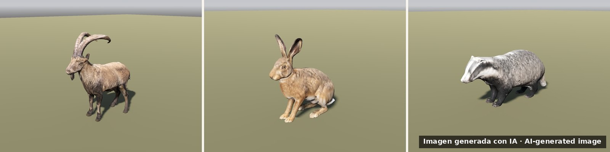

*Render (Modellansicht): die Spielmodelle auf glattem Boden, ohne Animation.*

## Kampf

- **Aschekrieger in vier Rängen:** Gewöhnlich, Veteran, Elite und Herr der Asche. Jeder Rang hat mehr Leben und mehr Schaden als der vorherige und führt längere Kombos, Finten oder Umgehungen aus. Ein **Kampfdirektor** entscheidet, wer wann angreift.
- **Verteidigung:** Deckung, Ablenkung, Ausweichrolle und Zielerfassung.
- **Waffen:** Man beginnt mit den Fäusten und mit dem, was die Umgebung bietet (ein Stock, ein Stein oder eine Fackel). Die **Falcata** und die **Caetra** (der iberische Schild) bekommt man im Spiel.
- **In Entwicklung:** ein normaler und ein starker Angriff für jede Waffenart. In den Daten gibt es schon die Schleuder, das Soliferreum, das Saunion und das Antennenschwert, aber man kann sie im Spiel noch nicht erwerben.

## Historische Genauigkeit

- In unseren Designdokumenten ist jedes historische Element gekennzeichnet: **verlässlich**, **zweifelhaft**, **Legende** oder **erfunden**.
- **Antike Quellen:** Polybios, Livius, Appian, Strabon, Diodor und Plinius. **Archäologie:** Edeta, La Bastida de les Alcusses, Collado de los Jardines, Castellar, Cabezo Lucero, Aguilar de Anguita und die Castros von Coaña und Santa Tegra.
- **Hausregeln:**
  - Vor 1492 gibt es keine Lebensmittel amerikanischen Ursprungs.
  - Die iberischen Häuser sind rechteckig, mit Steinsockel und Lehmdach, nie mit Satteldach aus Ziegeln.
  - Die Kleidung folgt den Quellen und Stücken wie der Dame von Baza.
  - Das Klima beruht auf echten Daten der AEMET.

## Technik

- **Godot 4.7** mit GDScript, zuerst für den PC.
- Läuft mit dem Forward+-Renderer und mit dem Mobile-Renderer. Die Qualität hat fünf Stufen, von „sehr niedrig“ bis „Ultra“.
- Für die Animation werden die Werkzeuge von Godot 4.7 genutzt: Zwei-Knochen-IK für die Füße, Federn für die Nebenbewegung und Blicksteuerung.
- Eine Reihe automatischer Tests prüft bei jeder Änderung Maßstab, Wetter, Physik und Menüs.

## Status und Fahrplan

**In Entwicklung (vor der Demo).** Es gibt noch keine öffentliche Demo, keinen Trailer und keine Store-Seite. Vorhanden ist ein Prototyp mit Prototyp-Grafik. Die Aufnahmen unten stammen unverändert aus der Engine.

Fahrplan, in dieser Reihenfolge und **ohne zugesagte Termine**:

1. Ein spielbarer vertikaler Ausschnitt von 20–30 Minuten und eine öffentliche Demo.
2. Early Access auf dem PC mit der kompletten Ära 1.
3. Version 1.0 und Konsolen.
4. Die weiteren Ären.

Außerdem ist geplant:

- Stufenaufstieg an den Altären;
- Tagebuch-, Bestiarium- und Erfolgsbildschirme;
- Tastenbelegung und Touch-Steuerung im Spiel;
- Angeln und Wandklettern;
- Dungeon-Rätsel und Bosskämpfe, mit dem Cuélebre als Boss der Ära 1;
- Reiten;
- die englische Lokalisierung.

## Galerie

| | |
|---|---|
| 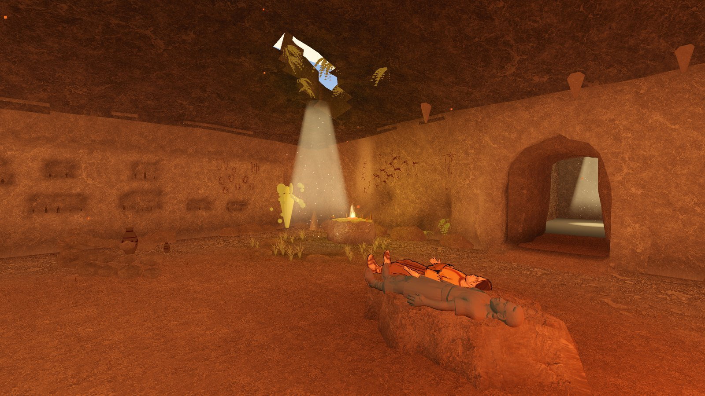 | 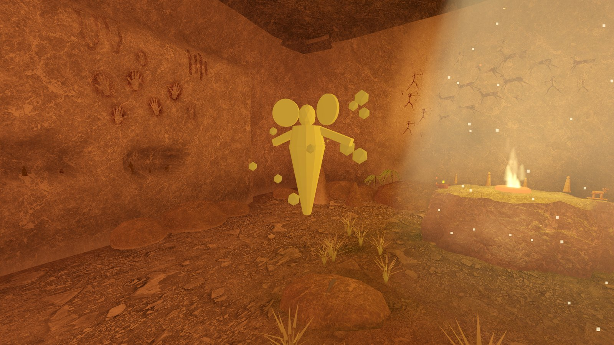 |
| Krypta des Heiligtums: das Lager, der Altar und der Lichtstrahl. *Echter Screenshot aus dem Spiel.* | Die Stimme des Heiligtums (vorläufige Figur) vor den Handmalereien. *Echter Screenshot aus dem Spiel.* |
| 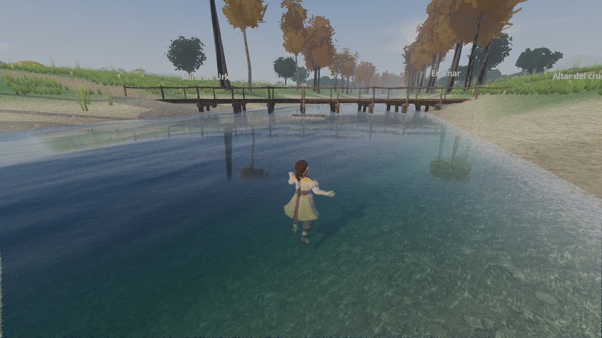 | 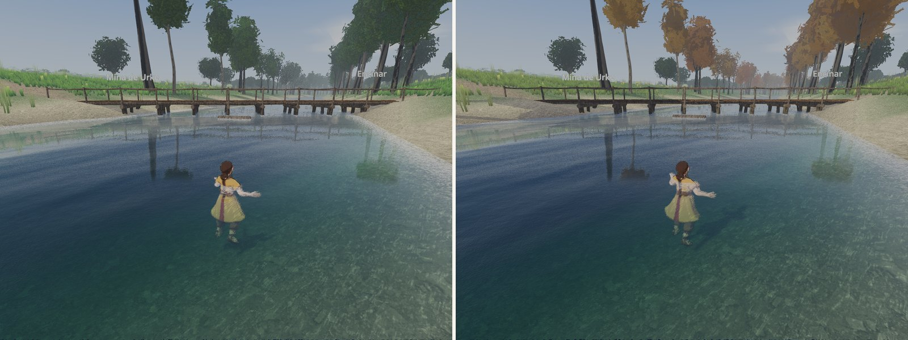 |
| Der Fluss und die Bohlenbrücke, im Herbst. *Echter Screenshot aus der Entwicklungsversion (16.11.2026).* | Derselbe Ort im Frühling und im Herbst. *Echte Screenshots aus der Entwicklungsversion (16.11.2026).* |
| 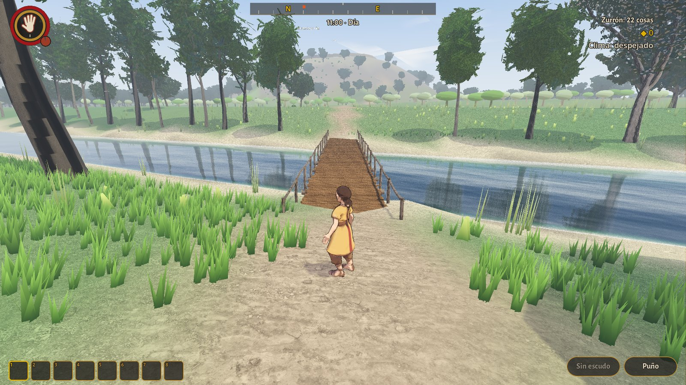 | 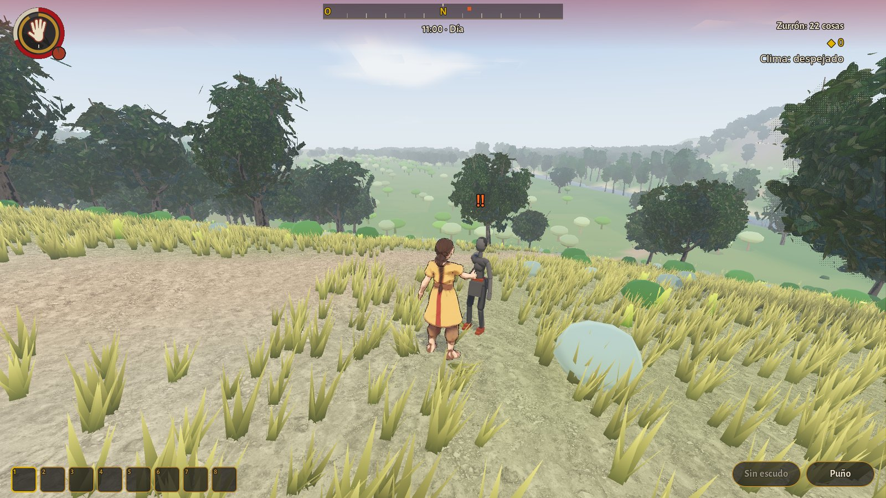 |
| Ankunft an der Brücke, mit der Spieloberfläche. *Echter Screenshot aus dem Spiel.* | Kampf gegen einen Aschekrieger, mit den Fäusten. *Echter Screenshot aus dem Spiel (Prototyp-Grafik).* |
| 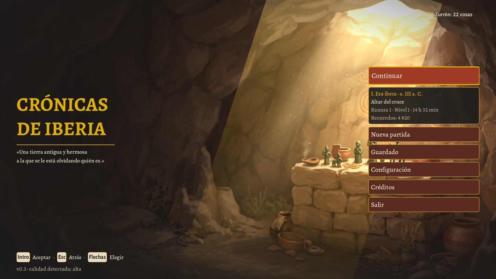 | 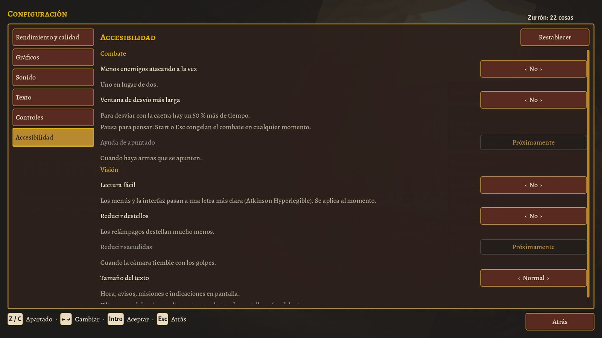 |
| Hauptmenü. *Echte Oberfläche, mit einem Testspielstand.* | Barrierefreiheitsoptionen: leicht lesbarer Text, weniger Blitzeffekte, weniger gleichzeitige Gegner und längeres Zeitfenster zum Ausweichen. *Echte Oberfläche.* |
| 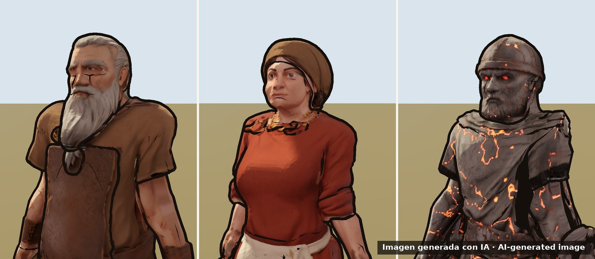 |  |
| Urke der Schmied, Bilos die Töpferin und ein Aschekrieger. *Render (Modellansicht, mit der Schattierung des Spiels).* | Iberische Tierwelt. *Render (Modellansicht).* |
|  |  |
| Drei Bewohnerinnen der iberischen Dörfer, von vorn. *Render (Modellansicht) von KI-generierten 3D-Modellen.* | Die sechs Ären, mit dem Wächter und der Wächterin. *KI-generierte Konzeptzeichnung (Google Gemini).* |

Die echten Screenshots wurden auf einem HP Omen (GTX 1050 Ti) in hoher oder Ultra-Qualität ohne Nachbearbeitung gemacht. Bei einigen Aufnahmen ist die Kamera fest, bei anderen ist es die Kamera des Spielers. Die Häuser des Dorfes und einige Tiere sind noch Prototyp-Grafik.

**Mit KI erstellte Bilder.** Sie tragen in einer Ecke den Vermerk „Imagen generada con IA · AI-generated image“. Das sind die Konzeptzeichnung der Ären (Google Gemini) und die Renders von Figuren und Tieren, die auf KI-generierten 3D-Modellen (TripoSG) beruhen. Die Modelle der drei Bewohnerinnen gehen auf Konzepte aus Google Gemini zurück.

## Wie KI eingesetzt wird

Wir sagen es, wie es ist. KI wird eingesetzt für:

- die Konzeptzeichnungen (Google Gemini);
- die 3D-Basismodelle, erzeugt aus freigegebenen Konzepten;
- die Stimmen und die Musik (Google Lyria);
- die Unterstützung bei Code, Recherche und Design.

Jedes KI-Element wird von einem Menschen geprüft und fertiggestellt, bevor es ins Spiel kommt. Mit KI erstellte Bilder tragen einen sichtbaren Vermerk, und die Credits des Spiels enthalten einen KI-Hinweis.

## Credits und Lizenzen

- **Godot Engine**: die Spiel-Engine (MIT-Lizenz).
- **Blender**: Nachbearbeitung und Rendern der Modelle (GPL-Lizenz; die mit Blender erzeugten Modelle und Bilder gehören uns).
- **TripoSG** von VAST-AI: aus den Konzepten erzeugte 3D-Modelle (MIT-Lizenz).
- **BiRefNet**: Freistellen der Konzepte vor dem Erzeugen des Modells (MIT-Lizenz).
- **scikit-image**: Extraktion der Modelloberfläche (BSD-3-Lizenz).
- **Google Gemini**: Konzeptzeichnungen.
- **IGN**: Relief des Digitalen Geländemodells MDT25 (CC BY 4.0).

## Über dieses Repository

Dieses Repository enthält nur Informationen: Der Quellcode ist privat.

## Kontakt

- E-Mail: hola@shaniawebstudio.com
- Website: https://shaniawebstudio.com

---
*Ein Produkt von Shania Webstudio.* · Copyright (c) 2026 Shania Webstudio.
