# Crónicas de Iberia — juego de supervivencia en mundo abierto en la Iberia prerromana

> Una aventura de supervivencia en mundo abierto y tercera persona ambientada en la Iberia prerromana, hacia el 225 a. C. Antes de la demo, en desarrollo.

De [Shania Webstudio](https://shaniawebstudio.com), Granada (España).

[English](README.md) · **Español** · [Français](README.fr.md) · [Deutsch](README.de.md) · [Português](README.pt.md)

*Captura real del motor, arte de prototipo.*

## Concepto

Eres un espíritu guardián ligado a un santuario íbero en una cueva. Despiertas cada vez que la península entra en crisis y vuelves a dormir cuando la crisis pasa. Sobrevive, combate y explora un mundo abierto en tercera persona inspirado en los pueblos prerromanos de la península ibérica: íberos, celtas y celtíberos.

Te guía la Voz del Santuario. Contra ti está la Ceniza, que corrompe a todos los pueblos por igual: en este juego ninguna cultura es «la mala». La Voz y la Ceniza son las dos mitades de la memoria de la tierra: una canta lo que fue y la otra quema lo que nadie quiere recordar.

El título oficial es «Crónicas de Iberia»; «Chronicles of Iberia» es un título provisional en inglés.

## Las eras

La historia se cuenta por eras. Construimos la primera entera antes de empezar la siguiente.

| Era | Época | Estado |
|---|---|---|
| 1 · Íbera | Hacia el 225 a. C., antes de que Roma llegue a la península | En desarrollo: es la que se juega en el prototipo |
| Interludio púnico | Qart Hadasht (Cartagena), fundada hacia el 227 a. C. | En diseño |
| 2 · Hispania romana | Del 150 a. C. al siglo I d. C.: Viriato, Numancia, Las Médulas, Emerita Augusta | En diseño |
| 3 · Reino visigodo | Finales del siglo VII y el año 711 | En diseño |
| 4 · Al-Ándalus | Siglo X | En diseño |
| 5 · Castilla del Cid | Siglo XI | En diseño |
| 6 · Granada | 1492 | En diseño |

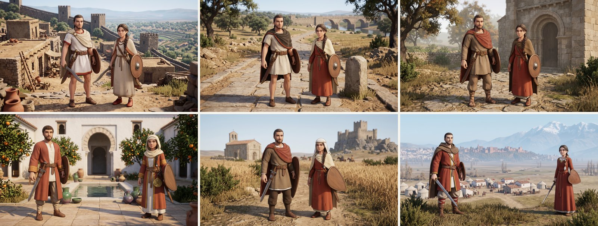

*Concept art generado con IA (Google Gemini) y revisado por el estudio: no es una captura del juego.*

## La protagonista

Al empezar la partida eliges a quién despertar: a **Neitin**, la Guardiana, o a **Iltir**, el Guardián. Son nombres provisionales inspirados en la onomástica íbera, y puedes cambiarlos. El rostro es el mismo en todas las eras: ojos castaños y pelo castaño oscuro, con trenza larga ella y coleta él. La ropa sí cambia con cada era.

En el dorso de la mano izquierda brilla la **marca del santuario**, un dibujo dorado que gana un trazo en cada era. La protagonista no habla: en los diálogos elige entre respuestas.

En la versión de desarrollo, los pies se apoyan en el terreno y los brazos se mueven al andar y al correr. También nada (a crol o como un perro), flota y sale por la orilla, y mira a lo que tiene cerca. Esto está en pruebas.

## Mundo y escala real

- **Escala real:** en el juego, 1 unidad es 1 metro. Una prueba automática compara la altura de personas y animales, árboles y casas con medidas reales, y admite un margen de ±15 %.
- **Región 1 · Edetania y montaña del norte:** una región de 2 × 2 km con terreno, vegetación, un río con corriente y puentes. Tiene un oppidum íbero tomado como modelo de Edeta (Tossal de Sant Miquel, Llíria), con PNJ que siguen rutinas diarias. Tiene también la cueva-santuario y su cripta, y dos mazmorras visitables.
- **Regiones 2 y 3 · Celtiberia y Meseta, y Costa castreña:** se llega a ellas por caminos desde la región 1. Están en la versión de desarrollo, en pruebas y con arte sencillo. Los caminos y estas regiones usan el relieve real del Modelo Digital del Terreno MDT25 del IGN (CC BY 4.0).

## Supervivencia, recolección, clima y estaciones

- **Supervivencia:** hambre y aguante. Al empezar eliges la dificultad, Normal o Supervivencia.
- **Muerte al estilo souls:** al morir sueltas tus «recuerdos» en una mancha, y vuelves al último altar que tocaste. Los altares guardan la partida.
- **Caza y cocina:** se cocina en el fuego del santuario, y las ranas se cazan con red.
- **Recolección** (versión de desarrollo): hay 15 cosas que recoger, cada una en su temporada. Son bellotas, moras, higos, aceitunas, madroños, espárragos, níscalos, amanitas, romero, tomillo, grana, palos, piedras, sílex y piñas de pino.
- **Día y clima:** un día dura 60 minutos reales. El tiempo tiene 7 estados (despejado, nubes, viento, lluvia, tormenta, niebla y nieve). La probabilidad de cada uno, mes a mes, sale de los valores climatológicos normales de AEMET (1981-2010).
- **Estaciones** (versión de desarrollo): el calendario del juego cambia la hora del amanecer y del ocaso. Los árboles de hoja caduca se ponen ocres en otoño y la hierba se seca en verano.

## Fauna

- En los datos del juego hay **37 especies con comportamiento propio**: manadas, depredadores y animales que huyen. Son salvajes (ciervo, corzo, jabalí, lobo ibérico, oso pardo, rebeco, uro…) y domésticas (buey, oveja, cabra, cerdo, perro, gallina, asno).
- Los **animales sagrados** no se cazan: el lince ibérico, el águila imperial y el quebrantahuesos.
- Fauna menor, peces e insectos: ranas, lagartijas, galápagos, sapos, truchas, mariposas, abejas, libélulas y luciérnagas.
- Los modelos de fauna de alta calidad están entrando en el juego poco a poco. Algunos animales todavía tienen el cuerpo provisional.

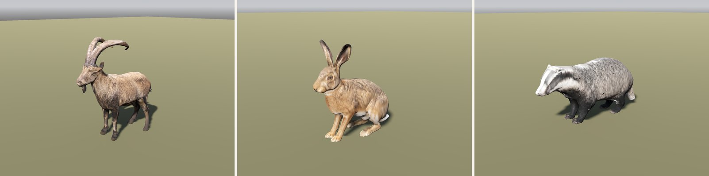

*Render (vista de modelo): los modelos del juego sobre un suelo liso, sin animación.*

## Combate

- **Guerreros de ceniza en cuatro rangos:** Común, Veterano, Élite y Señor de ceniza. Cada rango tiene más vida y más daño que el anterior, y hace combos más largos, fintas o rodeos. Un **director de combate** decide quién ataca y cuándo.
- **Defensa:** guardia, desvío, esquiva rodando y fijar un objetivo.
- **Armas:** se empieza a puño y con lo que hay en el entorno (un palo, una piedra o una antorcha). La **falcata** y la **caetra** (el escudo íbero) se consiguen jugando.
- **En desarrollo:** un ataque normal y uno fuerte para cada tipo de arma. En los datos ya están la honda, el soliferreum, el saunion y la espada de antenas, pero todavía no se pueden conseguir jugando.

## Rigor histórico

- En nuestros documentos de diseño, cada elemento histórico va etiquetado: **fiable**, **dudoso**, **leyenda** o **inventado**.
- **Fuentes clásicas:** Polibio, Livio, Apiano, Estrabón, Diodoro y Plinio. **Arqueología:** Edeta, La Bastida de les Alcusses, Collado de los Jardines, Castellar, Cabezo Lucero, Aguilar de Anguita y los castros de Coaña y Santa Tegra.
- **Normas de la casa:**
  - Antes de 1492 no hay alimentos de origen americano.
  - Las casas íberas son rectangulares, con zócalo de piedra y terrado de barro, nunca con teja a dos aguas.
  - El vestido sigue a las fuentes y a piezas como la Dama de Baza.
  - El clima se basa en datos reales de AEMET.

## Tecnología

- **Godot 4.7** con GDScript, primero para PC.
- Funciona con el renderizador Forward+ y con el renderizador móvil. La calidad tiene cinco niveles, de «muy baja» a «ultra».
- Para animar se usan las herramientas de Godot 4.7: IK de dos huesos para los pies, muelles para el movimiento secundario y control de la mirada.
- Una batería de pruebas automáticas comprueba en cada cambio la escala, el clima, la física y los menús.

## Estado y hoja de ruta

**En desarrollo (antes de la demo).** Todavía no hay demo pública, tráiler ni página de tienda. Lo que existe es un prototipo con arte de prototipo. Las capturas de abajo son del motor tal cual.

Hoja de ruta, en este orden y **sin fechas prometidas**:

1. Un corte vertical jugable de 20-30 minutos y una demo pública.
2. Acceso anticipado en PC con la era 1 completa.
3. Versión 1.0 y consolas.
4. Las eras siguientes.

También está previsto:

- subir de nivel en los altares;
- pantallas de diario, bestiario y logros;
- reasignar botones y controles táctiles en el juego;
- pesca y escalada de paredes;
- puzles de mazmorra y jefes, con el Cuélebre como jefe de la era 1;
- montar a caballo;
- la localización al inglés.

## Galería

| | |
|---|---|
| 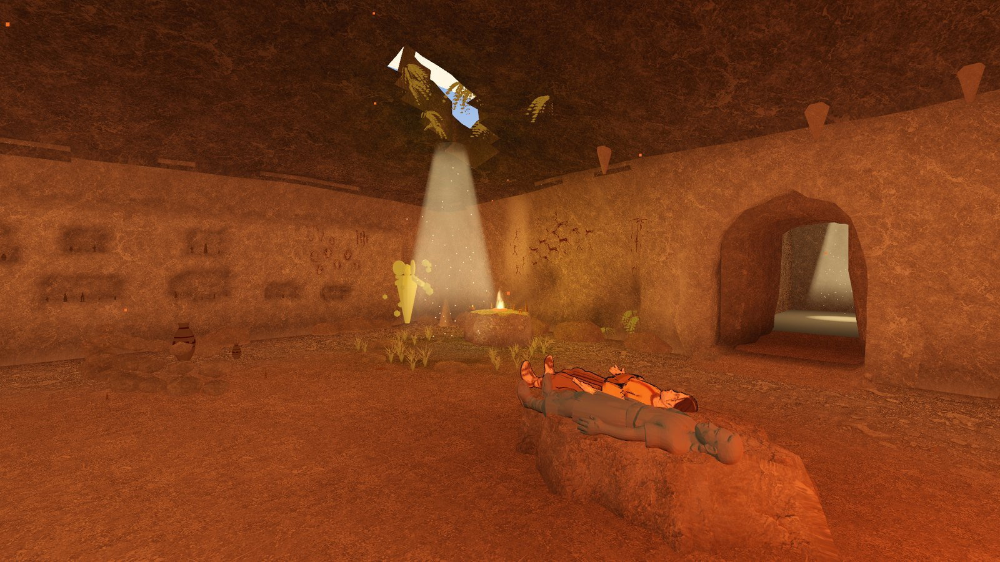 | 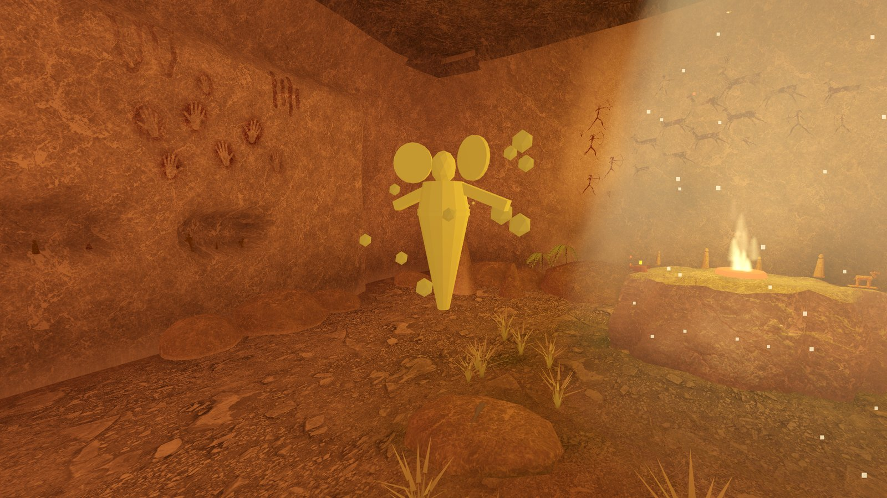 |
| Cripta del santuario: el lecho, el altar y el haz de luz. *Captura real del juego.* | La Voz del Santuario (figura provisional) ante las pinturas de manos. *Captura real del juego.* |
| 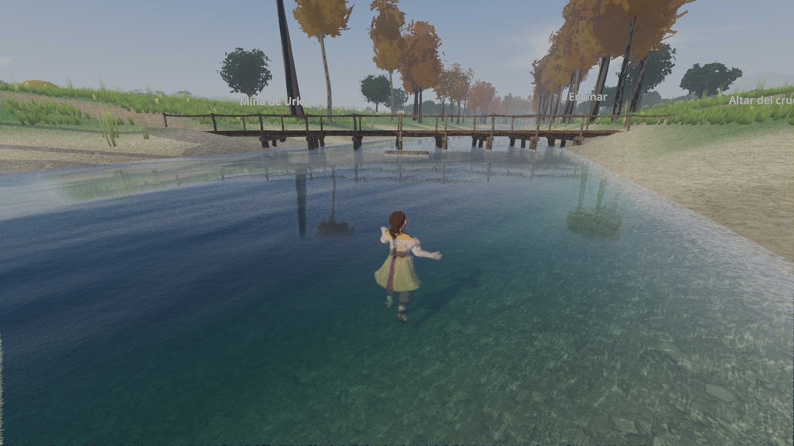 | 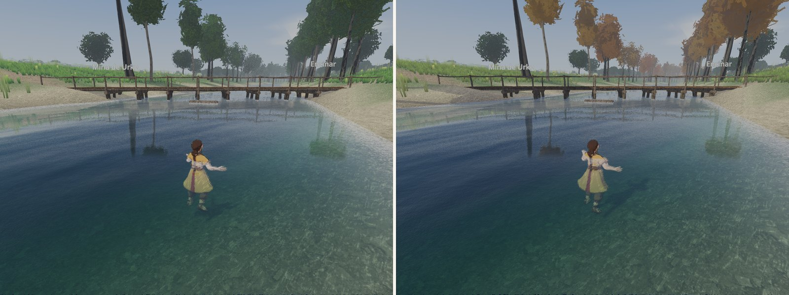 |
| El río y el puente de tablas, en otoño. *Captura real de la versión de desarrollo (16-11-2026).* | El mismo sitio en primavera y en otoño. *Capturas reales de la versión de desarrollo (16-11-2026).* |
| 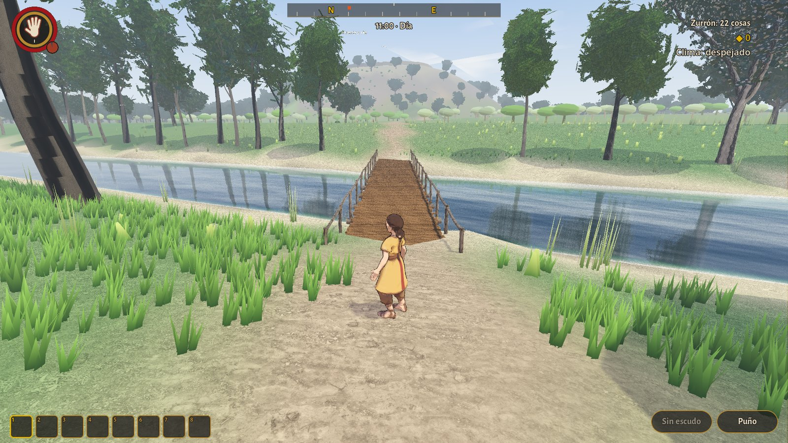 | 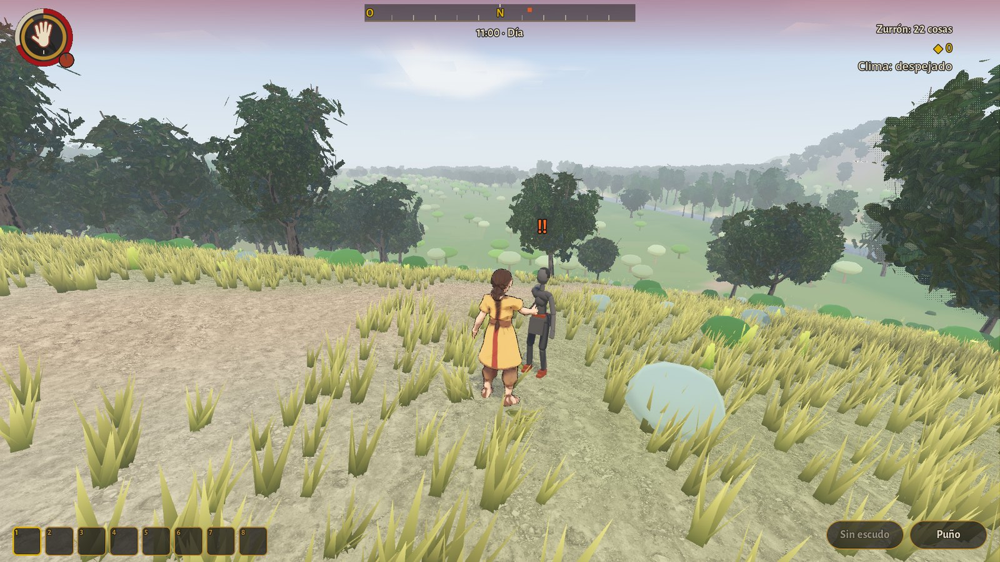 |
| Llegando al puente, con la interfaz del juego. *Captura real del juego.* | Combate contra un guerrero de ceniza, a puño. *Captura real del juego (arte de prototipo).* |
| 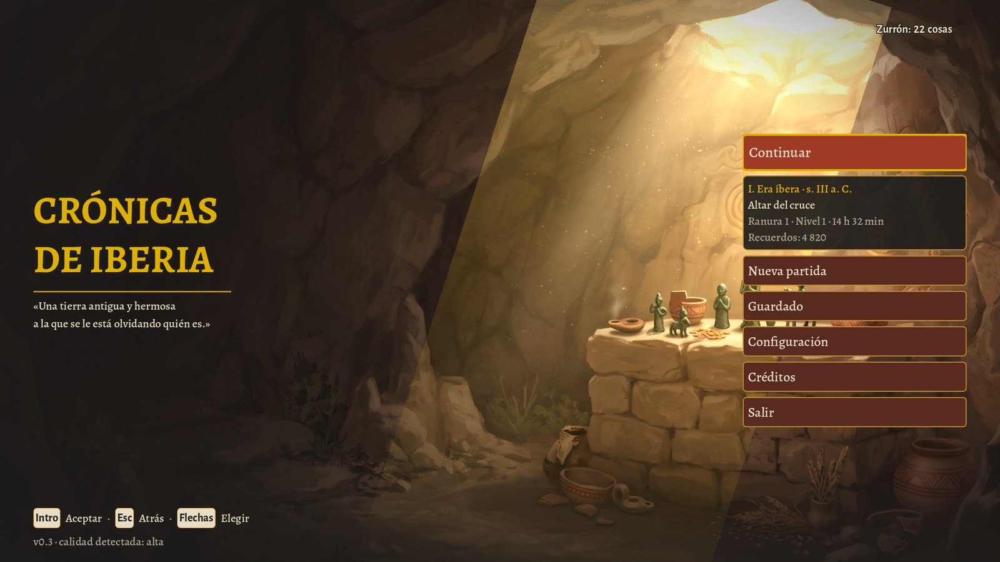 | 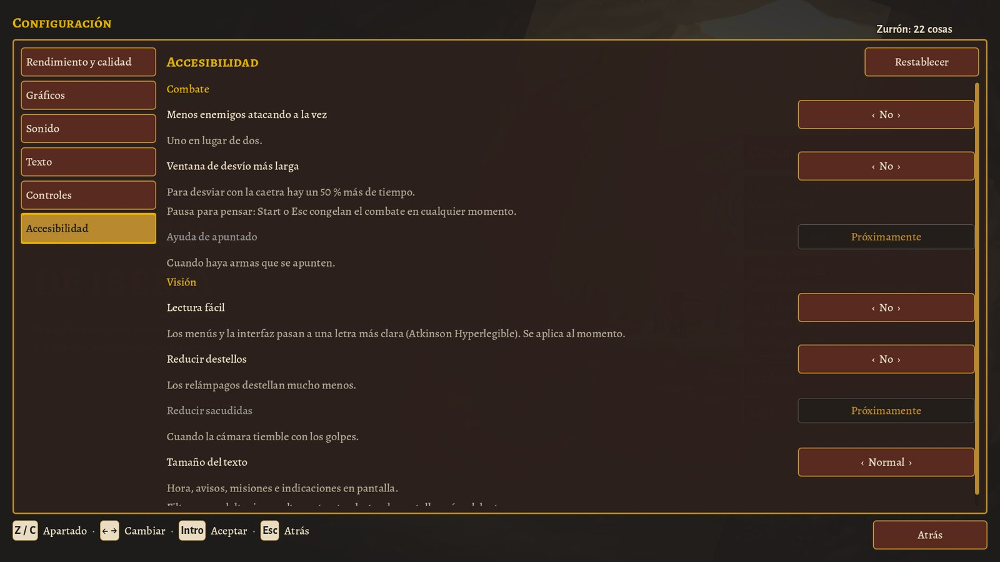 |
| Menú principal. *Interfaz real, con una partida de prueba.* | Opciones de accesibilidad: lectura fácil, reducir destellos, menos enemigos a la vez y ventana de desvío más larga. *Interfaz real.* |
| 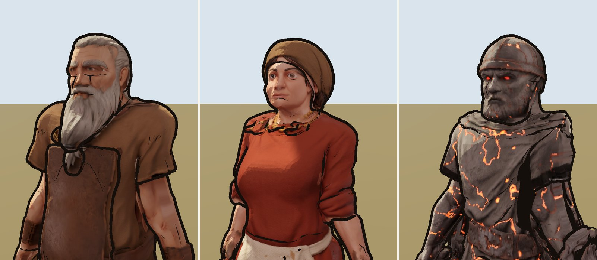 |  |
| Urke el herrero, Bilos la alfarera y un guerrero de ceniza. *Render (vista de modelo, con el sombreado del juego).* | Fauna ibérica. *Render (vista de modelo).* |

Las capturas reales están hechas en un HP Omen (GTX 1050 Ti) en calidad alta o ultra, sin retoques. En unas tomas la cámara está fija y en otras es la del jugador. Las casas del poblado y algunos animales todavía son arte de prototipo.

## Cómo se usa la IA

Lo decimos como es. La IA se usa para:

- el arte conceptual (Google Gemini);
- las mallas 3D base, generadas a partir de conceptos aprobados;
- las voces y la música (Google Lyria);
- el apoyo en código, investigación y diseño.

Toda pieza hecha con IA la revisa y la termina una persona antes de entrar en el juego. Las imágenes de concepto llevan una etiqueta de IA y los créditos del juego, un aviso de IA.

## Sobre este repositorio

Este repositorio solo contiene información: el código es privado.

## Contacto

- Correo: hola@shaniawebstudio.com
- Web: https://shaniawebstudio.com

---
*Un producto de Shania Webstudio.* · Copyright (c) 2026 Shania Webstudio.
