# Crónicas de Iberia (Chronicles of Iberia) — jeu de survie en monde ouvert dans l'Ibérie préromaine

> Une aventure de survie en monde ouvert à la troisième personne, dans l’Ibérie préromaine, vers 225 av. J.-C. Avant la démo, en développement.

> **Avertissement : jeu en développement.** Crónicas de Iberia n’est pas encore terminé. Les images de cette page sont des images de travail et peuvent changer. *Mis à jour le 25/11/2026.*

Par [Shania Webstudio](https://shaniawebstudio.com), Granada (Espagne).

[English](README.md) · [Español](README.es.md) · **Français** · [Deutsch](README.de.md) · [Português](README.pt.md)

*Capture réelle du moteur, art de prototype.*

## Concept

Vous êtes un esprit gardien lié à un sanctuaire ibère dans une grotte. Vous vous éveillez chaque fois que la péninsule entre en crise et vous vous rendormez quand la crise passe. Survivez, combattez et explorez un monde ouvert à la troisième personne, inspiré des peuples préromains de la péninsule Ibérique : Ibères, Celtes et Celtibères.

La Voix du Sanctuaire vous guide. Contre vous se dresse la Cendre, qui corrompt tous les peuples de la même façon : dans ce jeu, aucune culture n’est « la méchante ». La Voix et la Cendre sont les deux moitiés de la mémoire de la terre : l’une chante ce qui fut, l’autre brûle ce que personne ne veut se rappeler.

Le titre officiel est « Crónicas de Iberia » ; « Chronicles of Iberia » est un titre anglais provisoire.

## Les ères

L’histoire se raconte par ères. Nous construisons la première en entier avant de commencer la suivante.

| Ère | Époque | État |
|---|---|---|
| 1 · Ibère | Vers 225 av. J.-C., avant l’arrivée de Rome dans la péninsule | En développement : c’est celle qui se joue dans le prototype |
| Interlude punique | Qart Hadasht (Carthagène), fondée vers 227 av. J.-C. | En conception |
| 2 · Hispanie romaine | De 150 av. J.-C. au Ier siècle apr. J.-C. : Viriathe, Numance, Las Médulas, Emerita Augusta | En conception |
| 3 · Royaume wisigoth | Fin du VIIe siècle et année 711 | En conception |
| 4 · Al-Andalus | Xe siècle | En conception |
| 5 · Castille du Cid | XIe siècle | En conception |
| 6 · Grenade | 1492 | En conception |

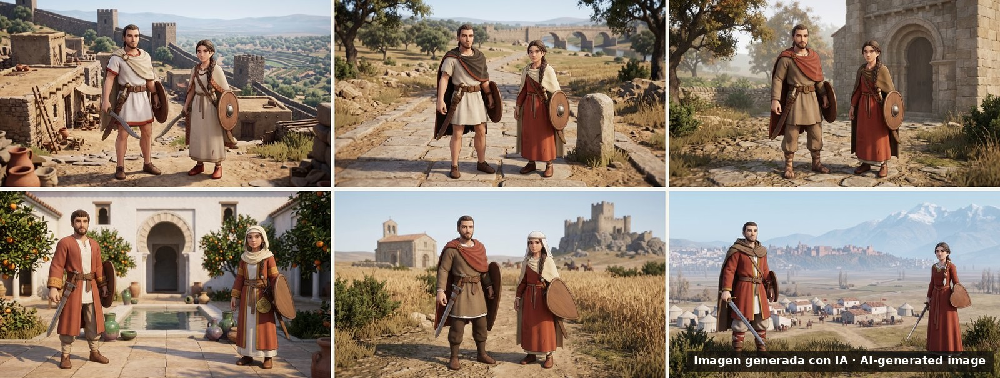

*Concept art généré par IA (Google Gemini) et relu par le studio : ce n’est pas une capture du jeu.*

## La protagoniste

Au début de la partie, vous choisissez qui éveiller : **Neitin**, la Gardienne, ou **Iltir**, le Gardien. Ce sont des noms provisoires inspirés de l’onomastique ibère, et vous pouvez les changer. Le visage est le même à toutes les ères : yeux marron et cheveux châtain foncé, avec une longue tresse pour elle et une queue-de-cheval pour lui. Les vêtements, eux, changent à chaque ère.

Sur le dos de la main gauche brille la **marque du sanctuaire**, un dessin doré qui gagne un trait à chaque ère. La protagoniste ne parle pas : dans les dialogues, vous choisissez parmi des réponses.

Dans la version de développement, les pieds s’appuient sur le terrain et les bras bougent à la marche et à la course. Elle nage aussi (en crawl ou comme un chien), flotte et sort par la rive, et regarde ce qui est proche. Cela est en cours de test.

## Les habitants des villages

Les villages ibères accueillent de nouveaux personnages, modélisés en 3D, chacun avec ses vêtements, sa coiffure et ses parures. Ils sont encore en test.

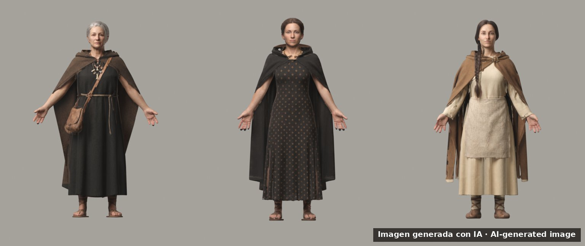

*Rendu (vue de modèle, sans animation) de modèles 3D générés par IA à partir de concepts réalisés avec Google Gemini.*

## Monde et échelle réelle

- **Échelle réelle :** dans le jeu, 1 unité vaut 1 mètre. Un test automatique compare la hauteur des personnes et des animaux, des arbres et des maisons avec des mesures réelles, et admet une marge de ±15 %.
- **Région 1 · Édétanie et montagne du nord :** une région de 2 × 2 km avec relief, végétation, une rivière à courant et des ponts. Elle comprend un oppidum ibère pris pour modèle d’Edeta (Tossal de Sant Miquel, Llíria), avec des PNJ qui suivent des routines quotidiennes. Elle comprend aussi la grotte-sanctuaire et sa crypte, et deux donjons visitables.
- **Régions 2 et 3 · Celtibérie et Meseta, et côte des castros :** on y accède par des chemins depuis la région 1. Elles sont dans la version de développement, en test et avec un art simple. Les chemins et ces régions utilisent le relief réel du modèle numérique de terrain MDT25 de l’IGN (CC BY 4.0).
- **Roches :** le paysage reçoit des rochers et des affleurements calcaires modélisés avec l’IA.

## Survie, cueillette, climat et saisons

- **Survie :** faim et endurance. Au départ, vous choisissez la difficulté, Normal ou Survie.
- **Mort à la souls :** en mourant, vous laissez vos « souvenirs » dans une tache, et vous revenez au dernier autel touché. Les autels sauvegardent la partie.
- **Chasse et cuisine :** on cuisine au feu du sanctuaire, et les grenouilles se capturent au filet.
- **Cueillette** (version de développement) : il y a 15 choses à ramasser, chacune en sa saison. Ce sont les glands, les mûres, les figues, les olives, les arbouses, les asperges, les lactaires délicieux, les amanites, le romarin, le thym, la kermès, les bâtons, les pierres, le silex et les pommes de pin.
- **Jour et climat :** un jour dure 60 minutes réelles. Le temps a 7 états (dégagé, nuages, vent, pluie, orage, brouillard et neige). La probabilité de chacun, mois par mois, vient des valeurs climatologiques normales de l’AEMET (1981-2010).
- **Saisons** (version de développement) : le calendrier du jeu change l’heure de l’aube et du crépuscule. Les arbres à feuilles caduques deviennent ocre en automne et l’herbe sèche en été.

## Faune

- Dans les données du jeu, il y a **37 espèces au comportement propre** : troupeaux, prédateurs et animaux qui fuient. Elles sont sauvages (cerf, chevreuil, sanglier, loup ibérique, ours brun, chamois, aurochs…) et domestiques (bœuf, brebis, chèvre, porc, chien, poule, âne).
- Les **animaux sacrés** ne se chassent pas : le lynx ibérique, l’aigle impérial et le gypaète barbu.
- Petite faune, poissons et insectes : grenouilles, lézards, tortues d’eau, crapauds, truites, papillons, abeilles, libellules et lucioles.
- Les modèles de faune de haute qualité entrent peu à peu dans le jeu. Certains animaux ont encore un corps provisoire.

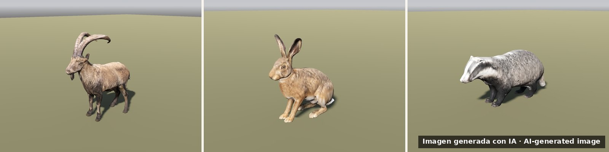

*Rendu (vue de modèle) : les modèles du jeu sur un sol lisse, sans animation.*

## Combat

- **Guerriers de cendre en quatre rangs :** Commun, Vétéran, Élite et Seigneur de cendre. Chaque rang a plus de vie et fait plus de dégâts que le précédent, et enchaîne des combos plus longs, des feintes ou des contournements. Un **directeur de combat** décide qui attaque et quand.
- **Défense :** garde, déviation, esquive en roulant et verrouillage d’une cible.
- **Armes :** on commence à mains nues et avec ce qu’offre l’environnement (un bâton, une pierre ou une torche). La **falcata** et la **caetra** (le bouclier ibère) s’obtiennent en jouant.
- **En développement :** une attaque normale et une attaque forte pour chaque type d’arme. La fronde, le soliferreum, le saunion et l’épée à antennes sont déjà dans les données, mais on ne peut pas encore les obtenir en jouant.

## Rigueur historique

- Dans nos documents de conception, chaque élément historique est étiqueté : **fiable**, **douteux**, **légende** ou **inventé**.
- **Sources classiques :** Polybe, Tite-Live, Appien, Strabon, Diodore et Pline. **Archéologie :** Edeta, La Bastida de les Alcusses, Collado de los Jardines, Castellar, Cabezo Lucero, Aguilar de Anguita et les castros de Coaña et de Santa Tegra.
- **Règles de la maison :**
  - Avant 1492, il n’y a pas d’aliments d’origine américaine.
  - Les maisons ibères sont rectangulaires, avec un soubassement de pierre et un toit-terrasse en terre, jamais avec un toit de tuiles à deux pans.
  - Le vêtement suit les sources et des pièces comme la Dame de Baza.
  - Le climat repose sur des données réelles de l’AEMET.

## Technologie

- **Godot 4.7** avec GDScript, d’abord pour PC.
- Il fonctionne avec le moteur de rendu Forward+ et avec le moteur de rendu mobile. La qualité a cinq niveaux, de « très basse » à « ultra ».
- Pour animer, on utilise les outils de Godot 4.7 : IK à deux os pour les pieds, ressorts pour le mouvement secondaire et contrôle du regard.
- Une batterie de tests automatiques vérifie à chaque changement l’échelle, le climat, la physique et les menus.

## État et feuille de route

**En développement (avant la démo).** Il n’y a pas encore de démo publique, de bande-annonce ni de page de boutique. Ce qui existe est un prototype avec un art de prototype. Les captures ci-dessous viennent du moteur, telles quelles.

Feuille de route, dans cet ordre et **sans dates promises** :

1. Une tranche verticale jouable de 20 à 30 minutes et une démo publique.
2. Accès anticipé sur PC avec l’ère 1 complète.
3. Version 1.0 et consoles.
4. Les ères suivantes.

Sont aussi prévus :

- la montée de niveau aux autels ;
- des écrans de journal, de bestiaire et de succès ;
- la reconfiguration des touches et des commandes tactiles dans le jeu ;
- la pêche et l’escalade de parois ;
- des énigmes de donjon et des boss, avec le Cuélebre comme boss de l’ère 1 ;
- l’équitation ;
- la localisation anglaise.

## Galerie

| | |
|---|---|
| 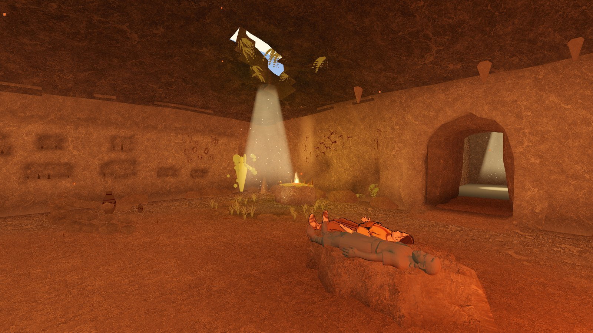 | 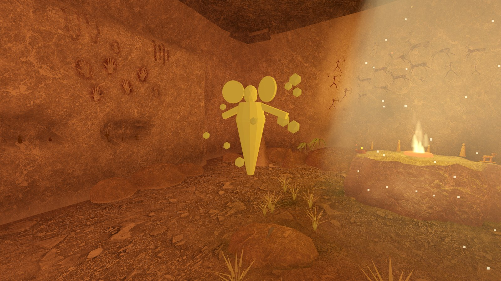 |
| Crypte du sanctuaire : le lit, l’autel et le faisceau de lumière. *Capture réelle du jeu.* | La Voix du Sanctuaire (figure provisoire) devant les peintures de mains. *Capture réelle du jeu.* |
| 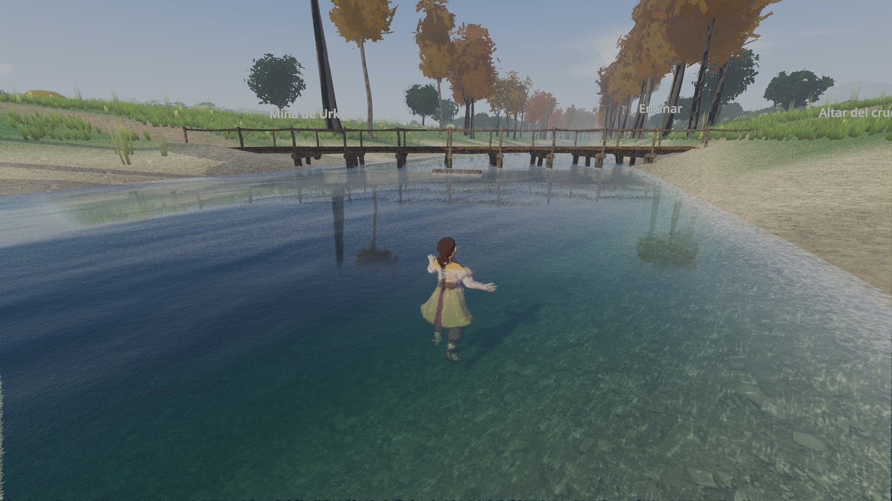 | 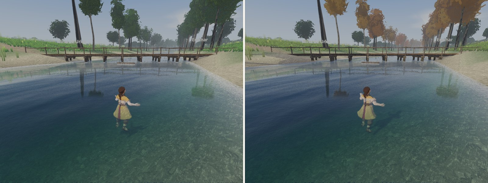 |
| La rivière et le pont de planches, en automne. *Capture réelle de la version de développement (16-11-2026).* | Le même endroit au printemps et en automne. *Captures réelles de la version de développement (16-11-2026).* |
| 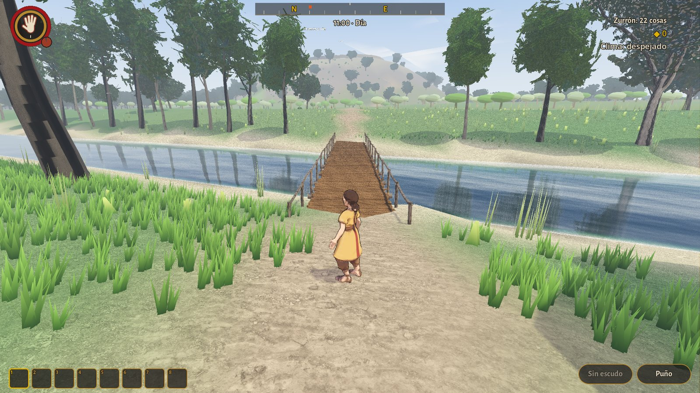 | 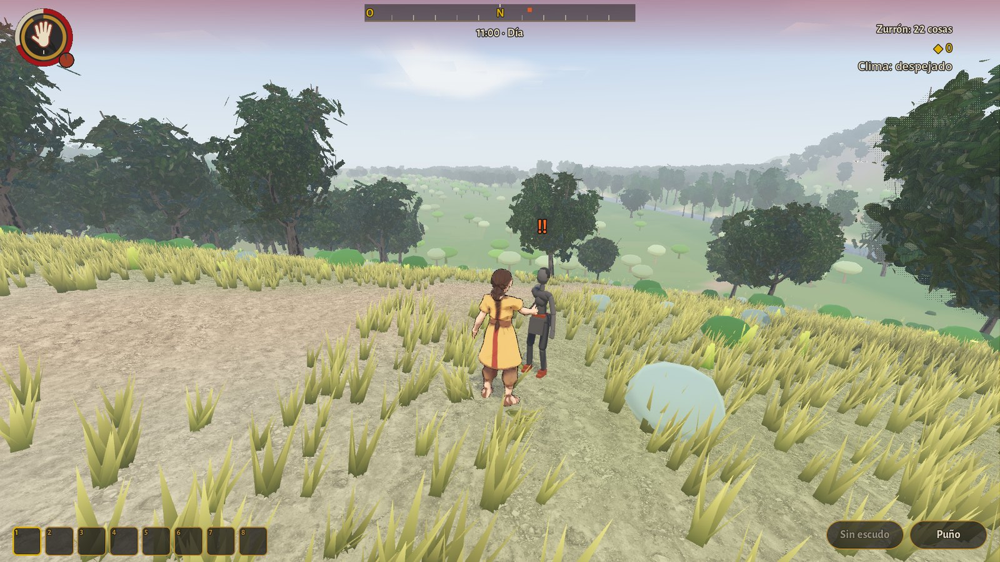 |
| Arrivée au pont, avec l’interface du jeu. *Capture réelle du jeu.* | Combat contre un guerrier de cendre, à mains nues. *Capture réelle du jeu (art de prototype).* |
| 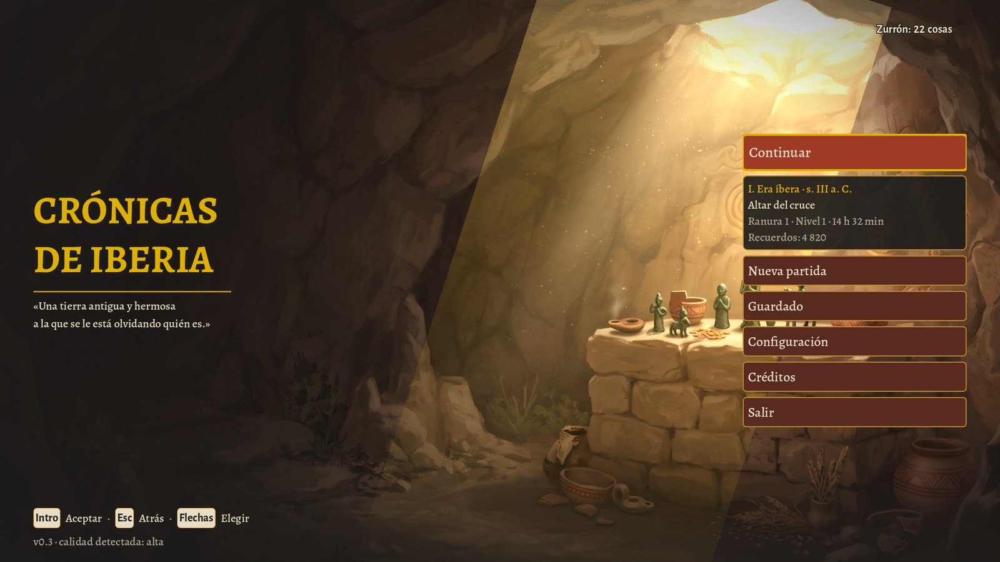 | 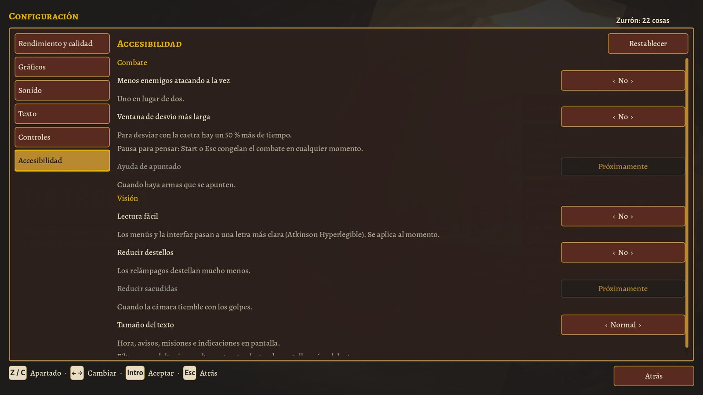 |
| Menu principal. *Interface réelle, avec une partie de test.* | Options d’accessibilité : lecture facile, réduction des flashs, moins d’ennemis à la fois et fenêtre de déviation plus longue. *Interface réelle.* |
| 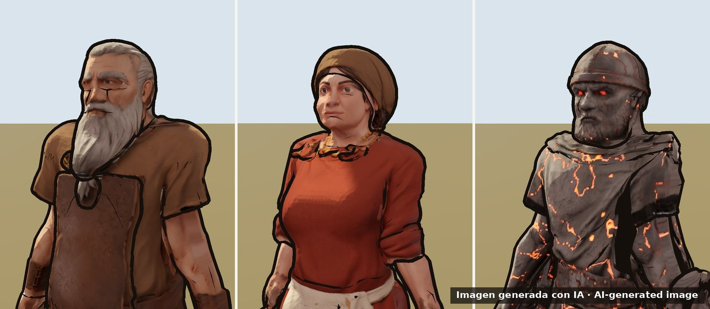 |  |
| Urke le forgeron, Bilos la potière et un guerrier de cendre. *Rendu (vue de modèle, avec l’ombrage du jeu).* | Faune ibérique. *Rendu (vue de modèle).* |
|  |  |
| Trois villageoises ibères, de face. *Rendu (vue de modèle) de modèles 3D générés par IA.* | Les six ères, avec le Gardien et la Gardienne. *Illustration conceptuelle générée par IA (Google Gemini).* |

Les captures réelles ont été faites sur un HP Omen (GTX 1050 Ti) en qualité haute ou ultra, sans retouche. Sur certaines prises, la caméra est fixe ; sur d’autres, c’est celle du joueur. Les maisons du village et certains animaux sont encore en art de prototype.

**Images faites avec l’IA.** Elles portent dans un coin la mention « Imagen generada con IA · AI-generated image ». Ce sont l’illustration conceptuelle des ères (Google Gemini) et les rendus des personnages et de la faune, réalisés à partir de modèles 3D générés par IA (TripoSG). Les modèles des trois villageoises partent de concepts réalisés avec Google Gemini.

## Comment l’IA est utilisée

Nous le disons tel quel. L’IA sert à :

- les illustrations conceptuelles (Google Gemini) ;
- les maillages 3D de base, générés à partir de concepts validés ;
- les voix et la musique (Google Lyria) ;
- l’aide au code, à la recherche et à la conception.

Chaque élément créé avec l’IA est relu et finalisé par un humain avant d’entrer dans le jeu. Les images faites avec l’IA portent une mention visible et les crédits du jeu un avis IA.

## Crédits et licences

- **Godot Engine** : le moteur du jeu (licence MIT).
- **Blender** : finition et rendu des modèles (licence GPL ; les modèles et les images produits avec Blender nous appartiennent).
- **TripoSG**, de VAST-AI : maillages 3D générés à partir des concepts (licence MIT).
- **BiRefNet** : détourage du fond des concepts avant de générer le maillage (licence MIT).
- **scikit-image** : extraction de la surface des maillages (licence BSD-3).
- **Google Gemini** : illustrations conceptuelles.
- **IGN** : relief du modèle numérique de terrain MDT25 (CC BY 4.0).

## À propos de ce dépôt

Ce dépôt ne contient que des informations : le code source est privé.

## Contact

- E-mail: hola@shaniawebstudio.com
- Site web: https://shaniawebstudio.com

---
*Un produit de Shania Webstudio.* · Copyright (c) 2026 Shania Webstudio.
