# Crónicas de Iberia (Chronicles of Iberia) — open-world survival game in pre-Roman Iberia

> A third-person open-world survival adventure set in pre-Roman Iberia, around 225 BC. Pre-demo, in development.

By [Shania Webstudio](https://shaniawebstudio.com), Granada (Spain).

**English** · [Español](README.es.md) · [Français](README.fr.md) · [Deutsch](README.de.md) · [Português](README.pt.md)

*Real in-engine capture, prototype art.*

## Concept

You are a guardian spirit bound to an Iberian sanctuary in a cave. You wake each time the peninsula falls into crisis and go back to sleep when the crisis passes. Survive, fight and explore a third-person open world inspired by the pre-Roman peoples of the Iberian Peninsula: Iberians, Celts and Celtiberians.

The Voice of the Sanctuary guides you. Against you stands the Ash, which corrupts all peoples equally: in this game no culture is "the bad one". The Voice and the Ash are the two halves of the land's memory: one sings what was, and the other burns what nobody wants to remember.

The official title is "Crónicas de Iberia"; "Chronicles of Iberia" is a working English title.

## The eras

The story is told in eras. We build the first one in full before starting the next.

| Era | Period | Status |
|---|---|---|
| 1 · Iberian | Around 225 BC, before Rome reaches the peninsula | In development: this is the one played in the prototype |
| Punic interlude | Qart Hadasht (Cartagena), founded around 227 BC | In design |
| 2 · Roman Hispania | 150 BC to the 1st century AD: Viriathus, Numantia, Las Médulas, Emerita Augusta | In design |
| 3 · Visigothic kingdom | Late 7th century and the year 711 | In design |
| 4 · Al-Andalus | 10th century | In design |
| 5 · Castile of the Cid | 11th century | In design |
| 6 · Granada | 1492 | In design |

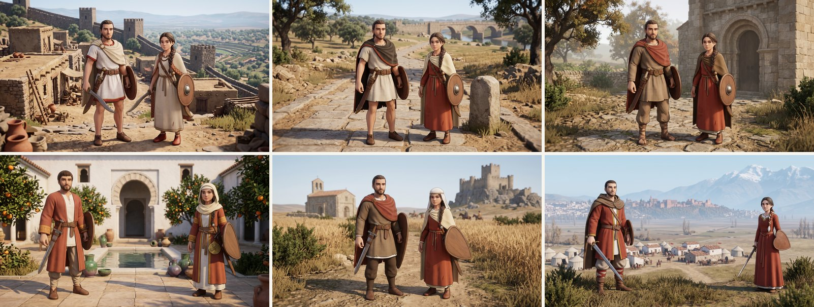

*AI-generated concept art (Google Gemini), reviewed by the studio: not a game screenshot.*

## The protagonist

At the start of a game you choose whom to awaken: **Neitin**, the female Guardian, or **Iltir**, the male Guardian. These are provisional names inspired by Iberian naming, and you can change them. The face is the same in every era: brown eyes and dark brown hair, with a long braid for her and a ponytail for him. The clothes do change with each era.

On the back of the left hand glows the **sanctuary mark**, a golden design that gains one stroke in each era. The protagonist does not speak: in dialogues you choose between answers.

In the development version, the feet rest on the terrain and the arms move when walking and running. The protagonist also swims (front crawl or doggy paddle), floats and climbs out at the bank, and looks at what is nearby. This is being tested.

## World and real scale

- **Real scale:** in the game, 1 unit is 1 metre. An automated test compares the height of people and animals, trees and houses with real measurements, and allows a margin of ±15%.
- **Region 1 · Edetania and the northern mountains:** a 2 × 2 km region with terrain, vegetation, a river with a current and bridges. It has an Iberian oppidum modelled on Edeta (Tossal de Sant Miquel, Llíria), with NPCs that follow daily routines. It also has the cave sanctuary and its crypt, and two visitable dungeons.
- **Regions 2 and 3 · Celtiberia and the Meseta, and the Castro Coast (hillfort coast):** you reach them by paths from region 1. They are in the development version, in testing and with simple art. The paths and these regions use the real relief of the MDT25 Digital Terrain Model of the IGN (CC BY 4.0).

## Survival, gathering, weather and seasons

- **Survival:** hunger and stamina. At the start you choose the difficulty, Normal or Survival.
- **Souls-style death:** when you die you drop your "memories" in a stain, and you return to the last altar you touched. Altars save the game.
- **Hunting and cooking:** you cook at the sanctuary fire, and frogs are caught with a net.
- **Gathering** (development version): there are 15 things to gather, each in its own season. They are acorns, blackberries, figs, olives, strawberry-tree fruit, wild asparagus, saffron milk caps, fly agarics, rosemary, thyme, kermes, sticks, stones, flint and pine cones.
- **Day and weather:** a day lasts 60 real minutes. The weather has 7 states (clear, clouds, wind, rain, storm, fog and snow). The probability of each, month by month, comes from the normal climatological values of AEMET (1981-2010).
- **Seasons** (development version): the in-game calendar changes the time of sunrise and sunset. Deciduous trees turn ochre in autumn and the grass dries out in summer.

## Wildlife

- In the game data there are **37 species with their own behaviour**: herds, predators and animals that flee. They are wild (red deer, roe deer, wild boar, Iberian wolf, brown bear, chamois, aurochs…) and domestic (ox, sheep, goat, pig, dog, hen, donkey).
- **Sacred animals** are not hunted: the Iberian lynx, the Spanish imperial eagle and the bearded vulture.
- Small fauna, fish and insects: frogs, lizards, terrapins, toads, trout, butterflies, bees, dragonflies and fireflies.
- High-quality wildlife models are entering the game little by little. Some animals still have a provisional body.

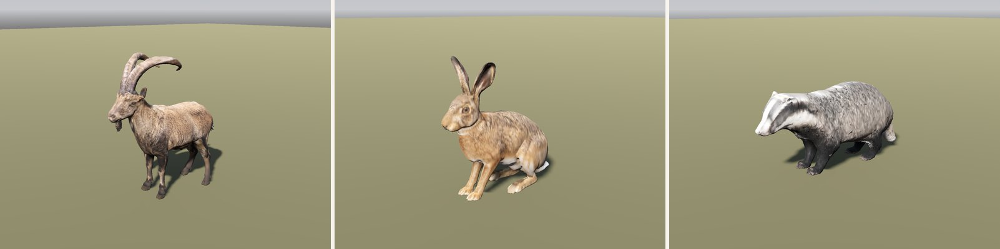

*Render (model view): the game's models on a plain floor, without animation.*

## Combat

- **Ash warriors in four ranks:** Common, Veteran, Elite and Ash Lord. Each rank has more health and more damage than the one before, and uses longer combos, feints or flanking moves. A **combat director** decides who attacks and when.
- **Defence:** guard, parry, dodge roll and target lock.
- **Weapons:** you start with your fists and whatever is around (a stick, a stone or a torch). The **falcata** and the **caetra** (the Iberian shield) are obtained by playing.
- **In development:** one normal attack and one heavy attack for each type of weapon. The sling, the soliferreum, the saunion and the antennae sword are already in the data, but they cannot yet be obtained in play.

## Historical accuracy

- In our design documents, every historical element is tagged: **reliable**, **doubtful**, **legend** or **invented**.
- **Classical sources:** Polybius, Livy, Appian, Strabo, Diodorus and Pliny. **Archaeology:** Edeta, La Bastida de les Alcusses, Collado de los Jardines, Castellar, Cabezo Lucero, Aguilar de Anguita and the hillforts of Coaña and Santa Tegra.
- **House rules:**
  - Before 1492 there are no foods of American origin.
  - Iberian houses are rectangular, with a stone base and a flat mud roof, never with a pitched tile roof.
  - Clothing follows the sources and pieces such as the Lady of Baza.
  - The climate is based on real AEMET data.

## Technology

- **Godot 4.7** with GDScript, PC first.
- It runs with the Forward+ renderer and with the mobile renderer. Quality has five levels, from "very low" to "ultra".
- Animation uses Godot 4.7 tools: two-bone IK for the feet, springs for secondary motion and gaze control.
- A suite of automated tests checks scale, weather, physics and menus on every change.

## Status and roadmap

**In development (pre-demo).** There is no public demo, trailer or store page yet. What exists is a prototype with prototype art. The screenshots below are from the engine as it is.

Roadmap, in this order and **with no promised dates**:

1. A playable 20-30 minute vertical slice and a public demo.
2. Early access on PC with the whole of era 1.
3. Version 1.0 and consoles.
4. The following eras.

Also planned:

- levelling up at altars;
- journal, bestiary and achievement screens;
- button remapping and touch controls in the game;
- fishing and wall climbing;
- dungeon puzzles and bosses, with the Cuélebre as the boss of era 1;
- horse riding;
- English localisation.

## Gallery

| | |
|---|---|
| 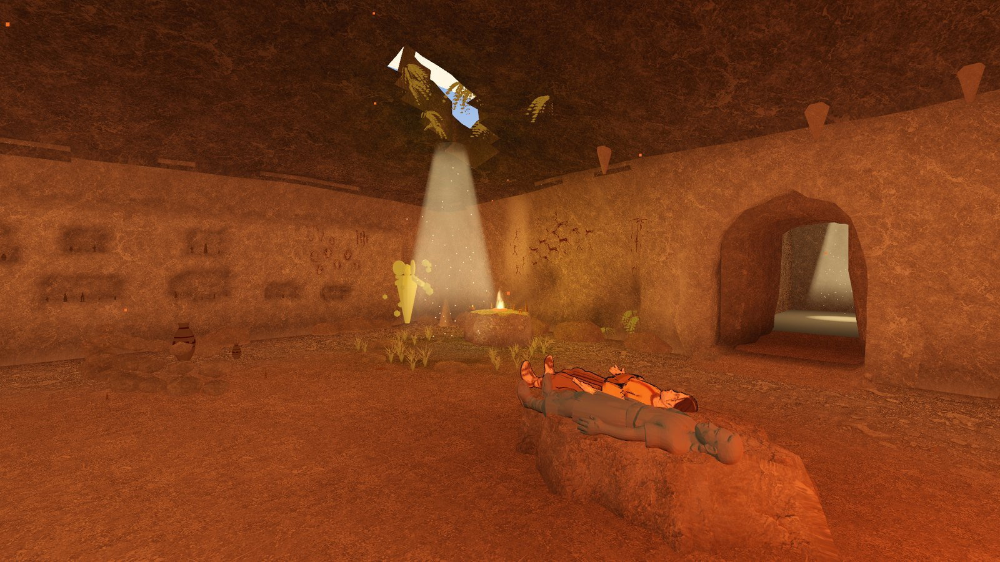 | 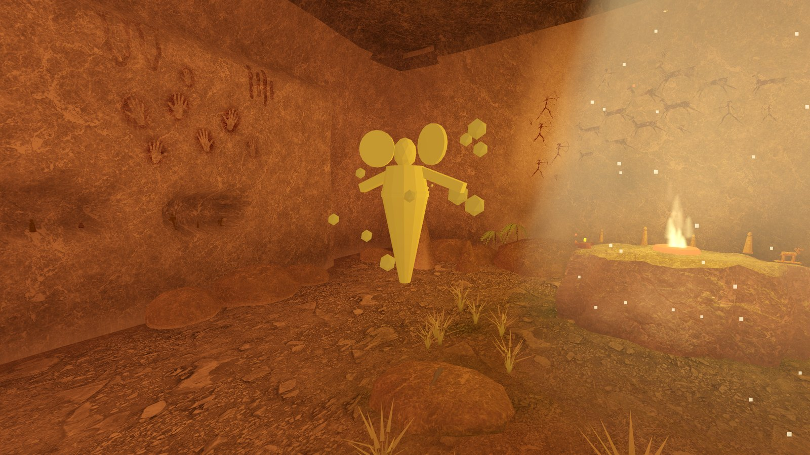 |
| Sanctuary crypt: the bed, the altar and the beam of light. *Real in-game screenshot.* | The Voice of the Sanctuary (provisional figure) before the hand paintings. *Real in-game screenshot.* |
| 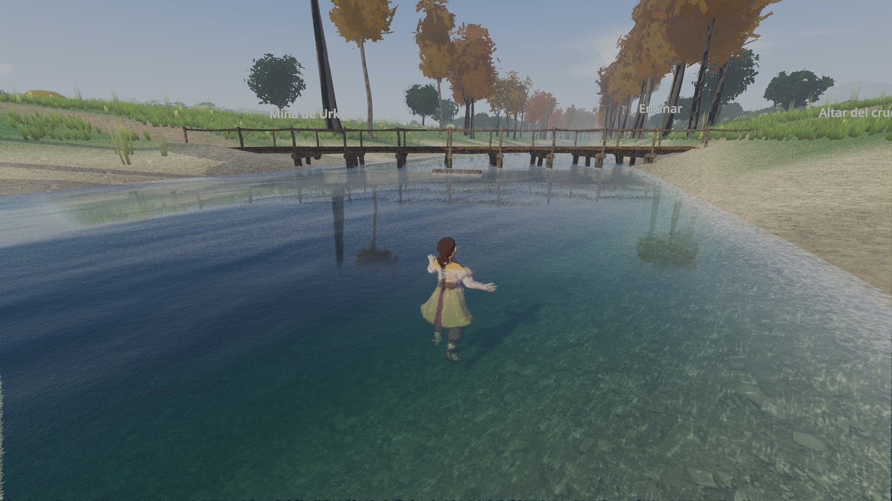 | 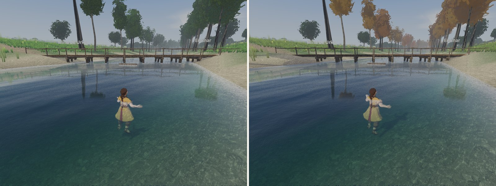 |
| The river and the plank bridge, in autumn. *Real in-game screenshot from the development version (16 Nov 2026).* | The same spot in spring and in autumn. *Real in-game screenshots from the development version (16 Nov 2026).* |
| 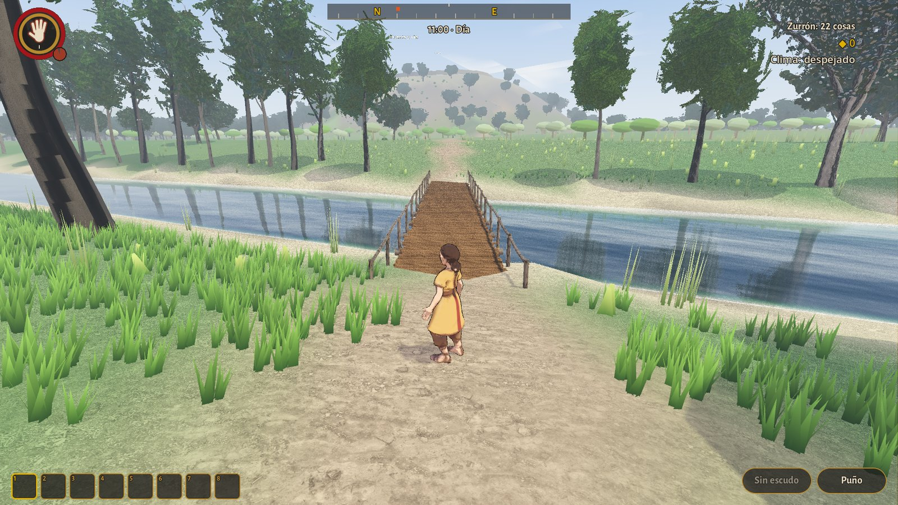 | 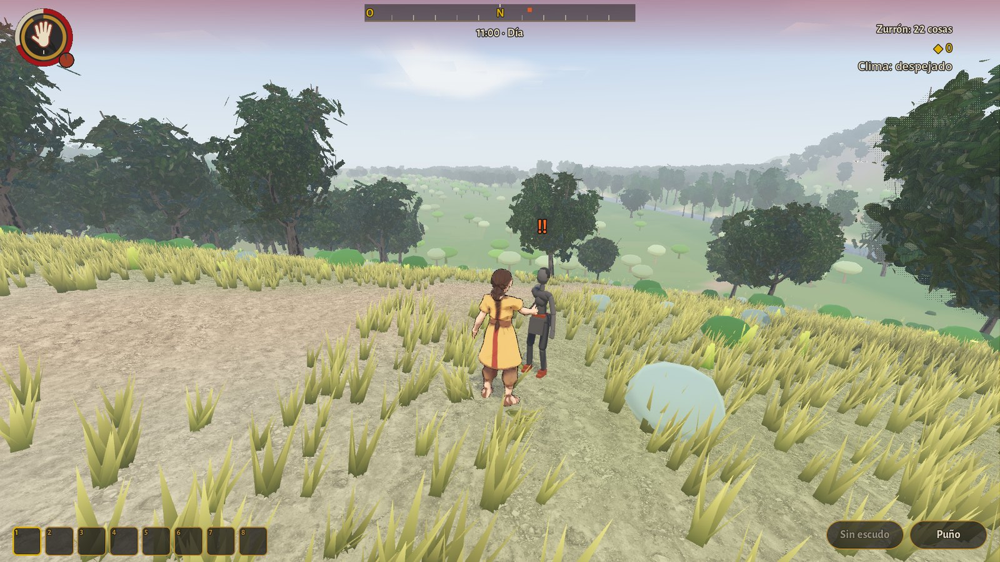 |
| Arriving at the bridge, with the game interface. *Real in-game screenshot.* | Combat against an Ash warrior, with fists. *Real in-game screenshot (prototype art).* |
| 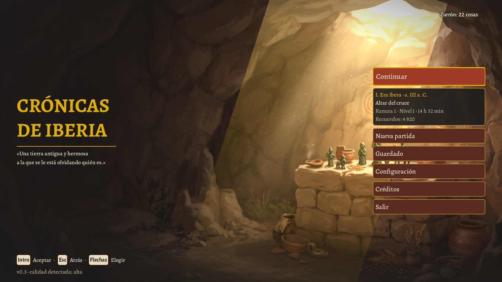 | 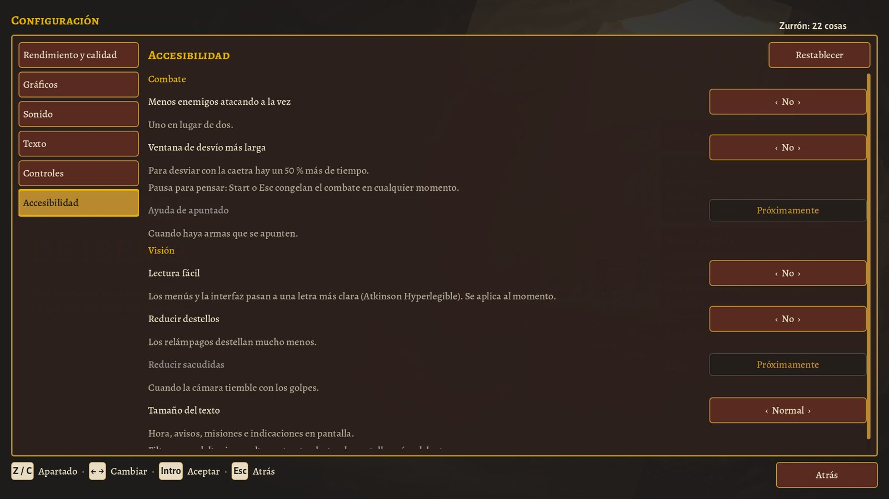 |
| Main menu. *Real interface, with a test save.* | Accessibility options: easy-read text, reduced flashes, fewer simultaneous enemies and a longer parry window. *Real interface.* |
| 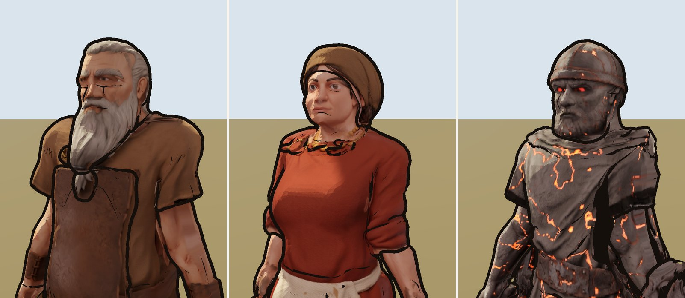 |  |
| Urke the smith, Bilos the potter and an Ash warrior. *Render (model view, with the game's shading).* | Iberian wildlife. *Render (model view).* |

The real screenshots were taken on an HP Omen (GTX 1050 Ti) at high or ultra quality, without retouching. In some shots the camera is fixed and in others it is the player's. The village houses and some animals are still prototype art.

## How we use AI

We say it as it is. AI is used for:

- concept art (Google Gemini);
- base 3D meshes, generated from approved concepts;
- voices and music (Google Lyria);
- support with code, research and design.

Every AI-made piece is reviewed and finished by a human before it goes into the game. Concept images carry an AI label and the game credits carry an AI notice.

## About this repository

This repository contains information only: the source code is private.

## Contact

- Email: hola@shaniawebstudio.com
- Website: https://shaniawebstudio.com

---
*A product by Shania Webstudio.* · Copyright (c) 2026 Shania Webstudio.
