# Crónicas de Iberia (Chronicles of Iberia) — jogo de sobrevivência em mundo aberto na Ibéria pré-romana

> Uma aventura de sobrevivência em mundo aberto na terceira pessoa, ambientada na Ibéria pré-romana, por volta de 225 a. C. Antes da demo, em desenvolvimento.

Por [Shania Webstudio](https://shaniawebstudio.com), Granada (Espanha).

[English](README.md) · [Español](README.es.md) · [Français](README.fr.md) · [Deutsch](README.de.md) · **Português**

*Captura real do motor, arte de protótipo.*

## Conceito

É um espírito guardião ligado a um santuário ibero numa gruta. Desperta sempre que a península entra em crise e volta a adormecer quando a crise passa. Sobreviva, lute e explore um mundo aberto na terceira pessoa, inspirado nos povos pré-romanos da Península Ibérica: iberos, celtas e celtiberos.

Guia-o a Voz do Santuário. Contra si está a Cinza, que corrompe todos os povos por igual: neste jogo, nenhuma cultura é «a má». A Voz e a Cinza são as duas metades da memória da terra: uma canta o que foi e a outra queima o que ninguém quer recordar.

O título oficial é «Crónicas de Iberia»; «Chronicles of Iberia» é um título provisório em inglês.

## As eras

A história conta-se por eras. Construímos a primeira inteira antes de começar a seguinte.

| Era | Época | Estado |
|---|---|---|
| 1 · Ibera | Por volta de 225 a. C., antes de Roma chegar à península | Em desenvolvimento: é a que se joga no protótipo |
| Interlúdio púnico | Qart Hadasht (Cartagena), fundada por volta de 227 a. C. | Em design |
| 2 · Hispânia romana | De 150 a. C. ao século I d. C.: Viriato, Numância, Las Médulas, Emerita Augusta | Em design |
| 3 · Reino visigodo | Finais do século VII e o ano 711 | Em design |
| 4 · Al-Ândalus | Século X | Em design |
| 5 · Castela do Cid | Século XI | Em design |
| 6 · Granada | 1492 | Em design |

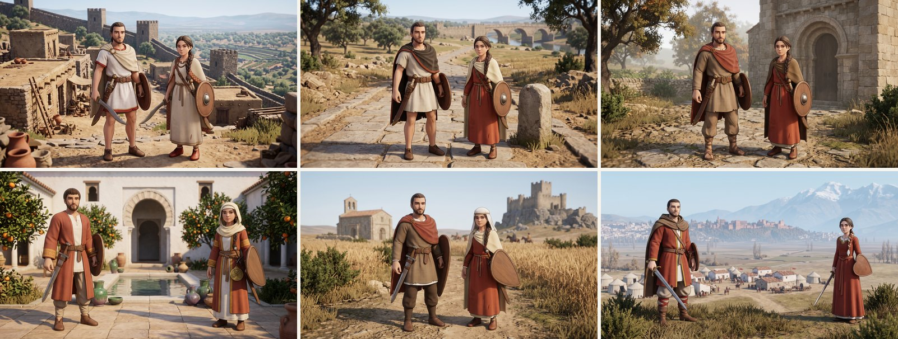

*Concept art gerado por IA (Google Gemini) e revisto pelo estúdio: não é uma captura do jogo.*

## A protagonista

No início da partida escolhe quem despertar: **Neitin**, a Guardiã, ou **Iltir**, o Guardião. São nomes provisórios, inspirados na onomástica ibera, e podem ser alterados. O rosto é o mesmo em todas as eras: olhos castanhos e cabelo castanho-escuro, com trança comprida ela e rabo de cavalo ele. A roupa muda em cada era.

No dorso da mão esquerda brilha a **marca do santuário**, um desenho dourado que ganha um traço em cada era. A protagonista não fala: nos diálogos, escolhe entre respostas.

Na versão de desenvolvimento, os pés apoiam-se no terreno e os braços mexem-se ao andar e ao correr. Também nada (em crawl ou como um cão), flutua e sai pela margem, e olha para o que tem perto. Isto está em testes.

## Mundo e escala real

- **Escala real:** no jogo, 1 unidade é 1 metro. Um teste automático compara a altura de pessoas e animais, árvores e casas com medidas reais, e admite uma margem de ±15 %.
- **Região 1 · Edetânia e montanha do norte:** uma região de 2 × 2 km com terreno, vegetação, um rio com corrente e pontes. Tem um oppidum ibero tomado como modelo de Edeta (Tossal de Sant Miquel, Llíria), com NPC que seguem rotinas diárias. Tem também a gruta-santuário e a sua cripta, e duas masmorras visitáveis.
- **Regiões 2 e 3 · Celtibéria e Meseta, e Costa castreja:** chega-se a elas por caminhos a partir da região 1. Estão na versão de desenvolvimento, em testes e com arte simples. Os caminhos e estas regiões usam o relevo real do Modelo Digital do Terreno MDT25 do IGN (CC BY 4.0).

## Sobrevivência, recoleção, clima e estações

- **Sobrevivência:** fome e resistência. No início escolhe a dificuldade, Normal ou Sobrevivência.
- **Morte ao estilo souls:** ao morrer, deixa as suas «memórias» numa mancha e regressa ao último altar que tocou. Os altares guardam o jogo.
- **Caça e cozinha:** cozinha-se na fogueira do santuário, e as rãs caçam-se com rede.
- **Recoleção** (versão de desenvolvimento): há 15 coisas para recolher, cada uma na sua estação. São bolotas, amoras, figos, azeitonas, medronhos, espargos, míscaros, amanitas, alecrim, tomilho, quermes, paus, pedras, sílex e pinhas.
- **Dia e clima:** um dia dura 60 minutos reais. O tempo tem 7 estados (limpo, nuvens, vento, chuva, tempestade, nevoeiro e neve). A probabilidade de cada um, mês a mês, sai dos valores climatológicos normais da AEMET (1981-2010).
- **Estações** (versão de desenvolvimento): o calendário do jogo muda a hora do nascer e do pôr do sol. As árvores de folha caduca ficam ocres no outono e a erva seca no verão.

## Fauna

- Nos dados do jogo há **37 espécies com comportamento próprio**: manadas, predadores e animais que fogem. São selvagens (veado, corço, javali, lobo-ibérico, urso-pardo, camurça, auroque…) e domésticas (boi, ovelha, cabra, porco, cão, galinha, burro).
- Os **animais sagrados** não se caçam: o lince-ibérico, a águia-imperial e o quebra-ossos.
- Fauna menor, peixes e insetos: rãs, lagartixas, cágados, sapos, trutas, borboletas, abelhas, libélulas e pirilampos.
- Os modelos de fauna de alta qualidade vão entrando no jogo aos poucos. Alguns animais ainda têm o corpo provisório.

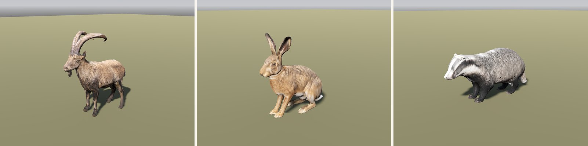

*Render (vista de modelo): os modelos do jogo sobre um chão liso, sem animação.*

## Combate

- **Guerreiros de cinza em quatro níveis:** Comum, Veterano, Elite e Senhor de cinza. Cada nível tem mais vida e mais dano do que o anterior, e faz combos mais longos, fintas ou rodeios. Um **diretor de combate** decide quem ataca e quando.
- **Defesa:** guarda, desvio, esquiva a rolar e fixar um alvo.
- **Armas:** começa-se à mão e com o que há no ambiente (um pau, uma pedra ou uma tocha). A **falcata** e a **caetra** (o escudo ibero) obtêm-se a jogar.
- **Em desenvolvimento:** um ataque normal e um forte para cada tipo de arma. Nos dados já estão a funda, o soliferreum, o saunion e a espada de antenas, mas ainda não se podem obter a jogar.

## Rigor histórico

- Nos nossos documentos de design, cada elemento histórico está etiquetado: **fiável**, **duvidoso**, **lenda** ou **inventado**.
- **Fontes clássicas:** Políbio, Lívio, Apiano, Estrabão, Diodoro e Plínio. **Arqueologia:** Edeta, La Bastida de les Alcusses, Collado de los Jardines, Castellar, Cabezo Lucero, Aguilar de Anguita e os castros de Coaña e Santa Tegra.
- **Normas da casa:**
  - Antes de 1492 não há alimentos de origem americana.
  - As casas iberas são retangulares, com soco de pedra e terraço de barro, nunca com telha de duas águas.
  - O vestuário segue as fontes e peças como a Dama de Baza.
  - O clima baseia-se em dados reais da AEMET.

## Tecnologia

- **Godot 4.7** com GDScript, primeiro para PC.
- Funciona com o renderizador Forward+ e com o renderizador móvel. A qualidade tem cinco níveis, de «muito baixa» a «ultra».
- Para animar usam-se as ferramentas do Godot 4.7: IK de dois ossos para os pés, molas para o movimento secundário e controlo do olhar.
- Uma bateria de testes automáticos verifica, a cada alteração, a escala, o clima, a física e os menus.

## Estado e roteiro

**Em desenvolvimento (antes da demo).** Ainda não há demo pública, trailer nem página de loja. O que existe é um protótipo com arte de protótipo. As capturas abaixo são do motor tal como está.

Roteiro, por esta ordem e **sem datas prometidas**:

1. Um corte vertical jogável de 20 a 30 minutos e uma demo pública.
2. Acesso antecipado no PC com a era 1 completa.
3. Versão 1.0 e consolas.
4. As eras seguintes.

Também está previsto:

- subir de nível nos altares;
- ecrãs de diário, bestiário e conquistas;
- remapear botões e controlos táteis no jogo;
- pesca e escalada de paredes;
- puzzles de masmorra e chefes, com o Cuélebre como chefe da era 1;
- montar a cavalo;
- a localização em inglês.

## Galeria

| | |
|---|---|
| 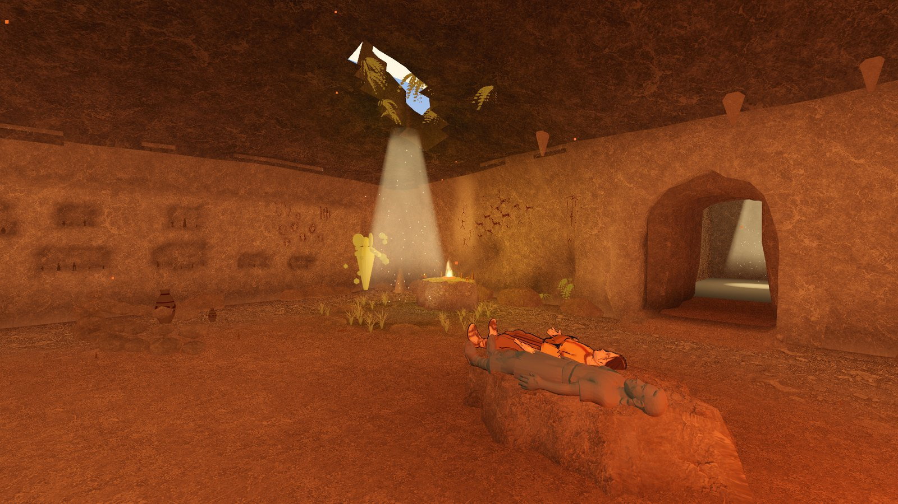 | 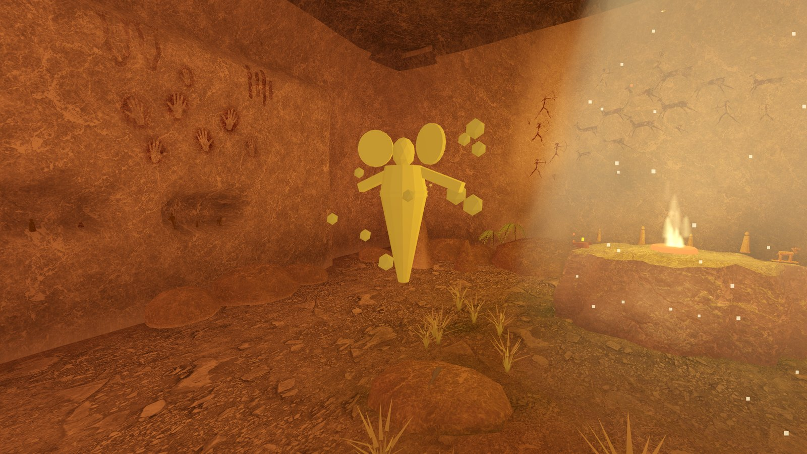 |
| Cripta do santuário: o leito, o altar e o feixe de luz. *Captura real do jogo.* | A Voz do Santuário (figura provisória) diante das pinturas de mãos. *Captura real do jogo.* |
| 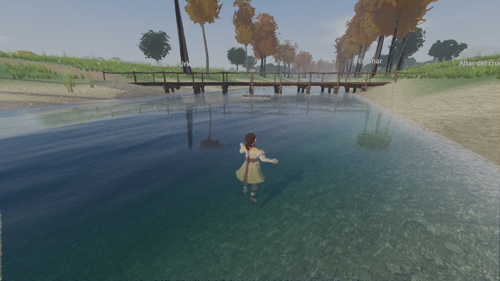 | 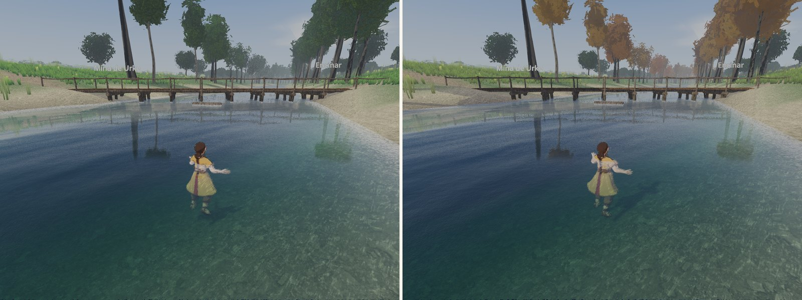 |
| O rio e a ponte de tábuas, no outono. *Captura real da versão de desenvolvimento (16-11-2026).* | O mesmo sítio na primavera e no outono. *Capturas reais da versão de desenvolvimento (16-11-2026).* |
| 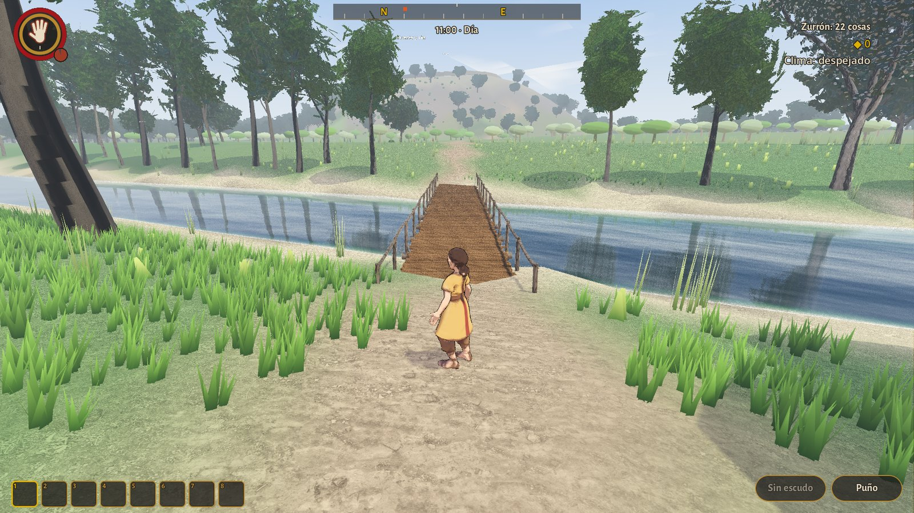 | 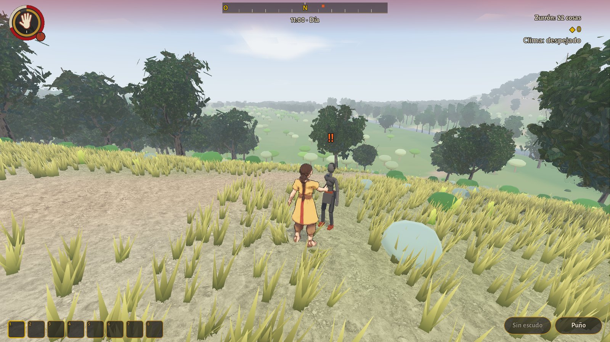 |
| A chegar à ponte, com a interface do jogo. *Captura real do jogo.* | Combate contra um guerreiro de cinza, à mão. *Captura real do jogo (arte de protótipo).* |
| 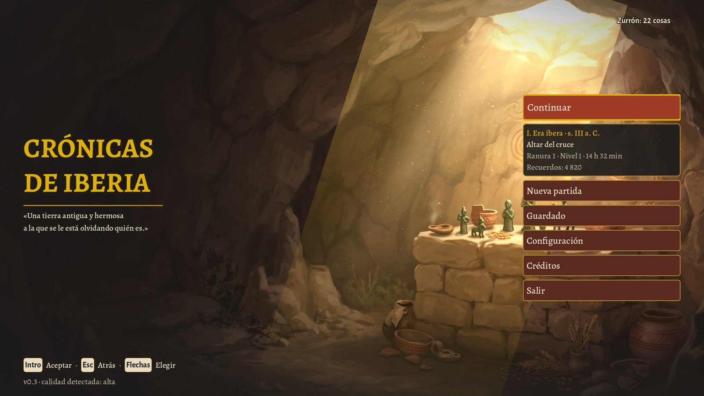 | 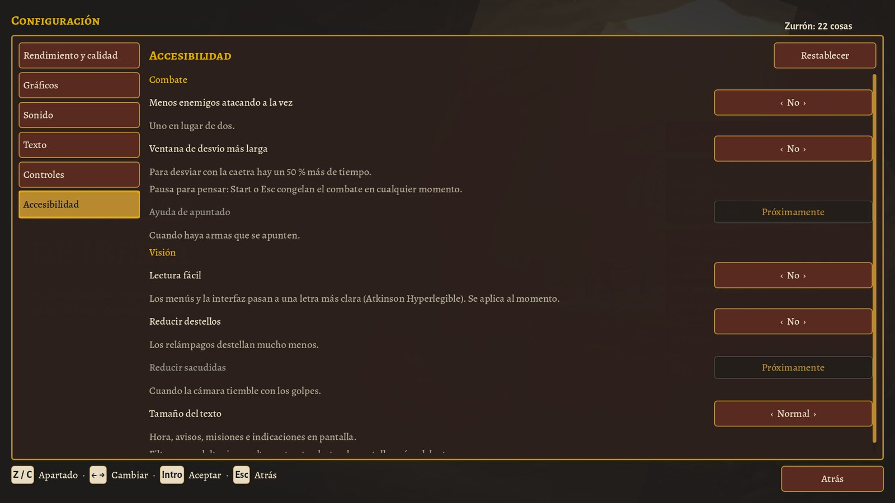 |
| Menu principal. *Interface real, com uma partida de teste.* | Opções de acessibilidade: leitura fácil, reduzir flashes, menos inimigos em simultâneo e janela de desvio mais longa. *Interface real.* |
| 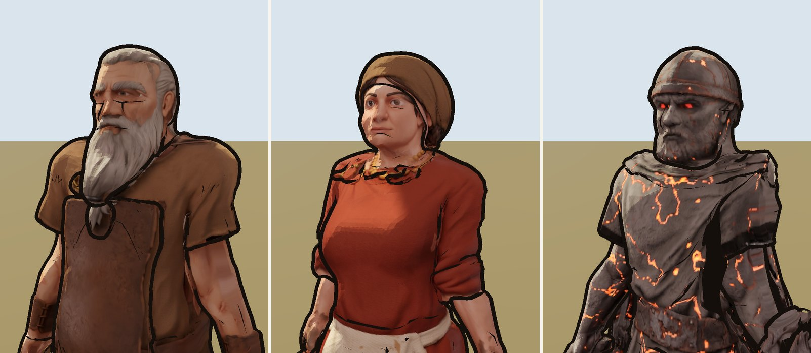 |  |
| Urke, o ferreiro, Bilos, a oleira, e um guerreiro de cinza. *Render (vista de modelo, com o sombreado do jogo).* | Fauna ibérica. *Render (vista de modelo).* |

As capturas reais foram feitas num HP Omen (GTX 1050 Ti) em qualidade alta ou ultra, sem retoques. Em algumas tomadas a câmara está fixa e noutras é a do jogador. As casas da povoação e alguns animais ainda são arte de protótipo.

## Como a IA é usada

Dizemo-lo como é. Usa-se IA para:

- arte concetual (Google Gemini);
- malhas 3D de base, geradas a partir de conceitos aprovados;
- vozes e música (Google Lyria);
- apoio em código, pesquisa e design.

Cada peça feita com IA é revista e finalizada por uma pessoa antes de entrar no jogo. As imagens de conceito levam uma etiqueta de IA e os créditos do jogo, um aviso de IA.

## Sobre este repositório

Este repositório contém apenas informação: o código é privado.

## Contacto

- E-mail: hola@shaniawebstudio.com
- Site: https://shaniawebstudio.com

---
*Um produto da Shania Webstudio.* · Copyright (c) 2026 Shania Webstudio.
